# TerraNet – pracovný návod na ClickUp a GitHub

Na jednej úlohe **Pridať blokovú schému** si vyskúšame, ako prevziať zadanie v ClickUpe, pripraviť zmenu na GitHube a po kontrole úlohu uzavrieť. GitHubovú časť zvládneš v prehliadači.

**Prvý prechod**  
[Zadaj úlohu](#úlohy-tímu-v-clickupe) → [pridaj schému do GitHubu](#prvá-zmena-na-githube) → [dokonči úlohu](#dokončenie-úlohy-v-clickupe). Ak pri zlučovaní GitHub ukáže konflikt, otvor [postup pri konflikte](#konflikt-v-readme).

## Úlohy tímu v ClickUpe

<details>
<summary><strong>Založ priestor TerraNet</strong> · pre človeka, ktorý nastavuje projekt</summary>

1. V bočnom paneli klikni na **+ Create → Space**.

   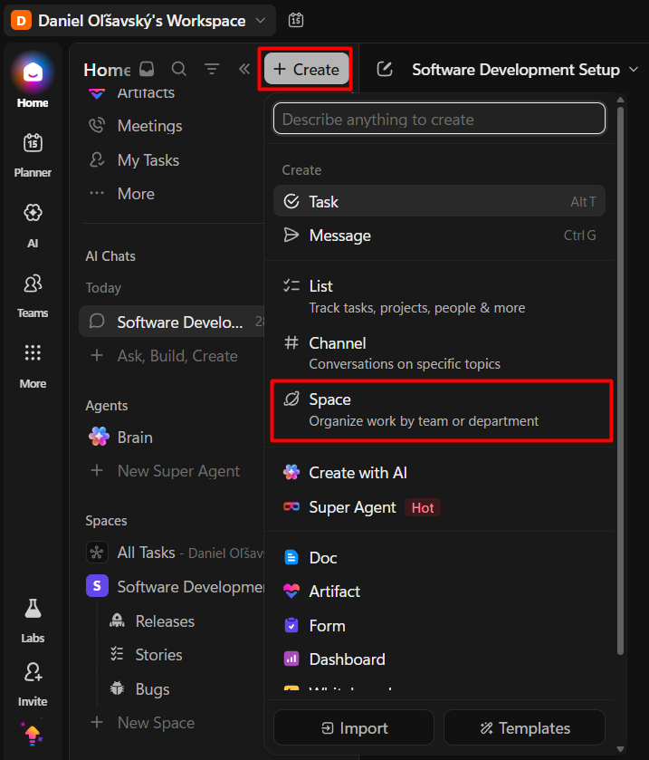

2. Zadaj názov **TerraNet**. Ak má byť priestor dostupný len vybraným členom, zapni **Make Private** a cez **Add member** pridaj ľudí, ktorí v ňom budú pracovať. Potom klikni na **Continue**.

   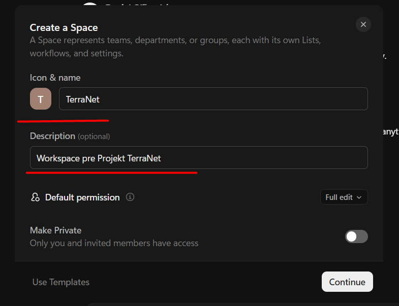

   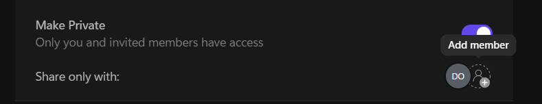

3. Vyber jednoduché nastavenie, napríklad **Starter**. V **Task statuses** môžeš vybrať šablónu **Normal**, aby si mal rovnaké stavy ako na nástenke v tomto návode. Klikni na **Create Space**.

   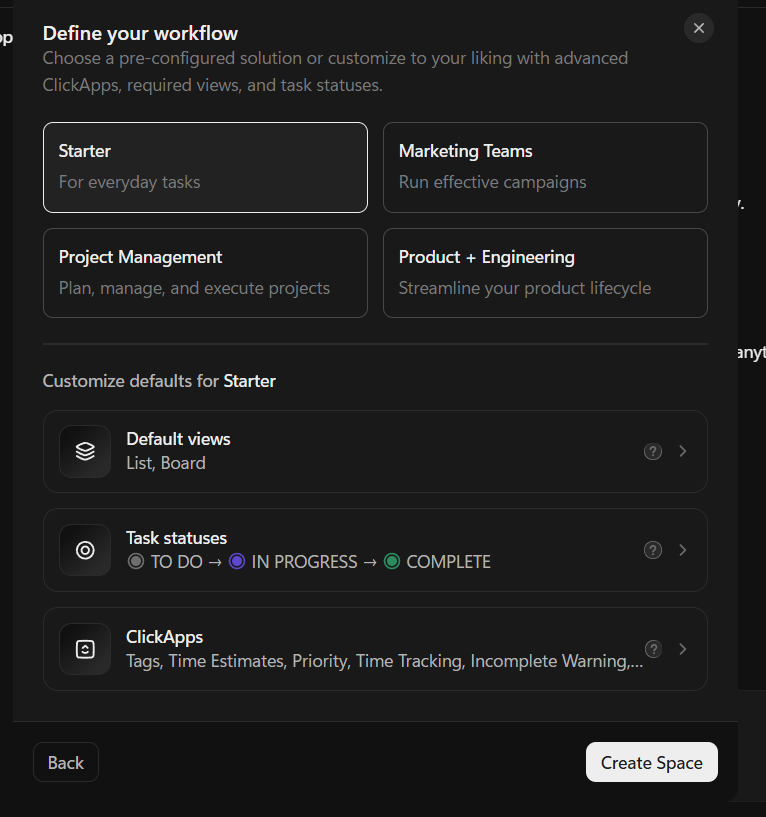

   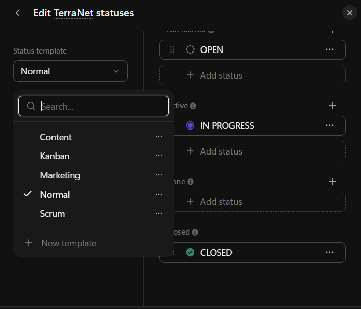

4. V priestore otvor existujúci zoznam úloh. Ak v ňom ešte žiadny nie je, klikni na **+** pri názve priestoru → **List**, zadaj **Prvý prototyp** a klikni na **Create**.

   [ClickUp Help – vytvorenie priestoru](https://help.clickup.com/hc/en-us/articles/6309390855319-Create-and-edit-Spaces) · [Vytvorenie zoznamu](https://help.clickup.com/hc/en-us/articles/33944215483159-Create-a-List)

</details>

<details>
<summary><strong>Zadaj úlohu a priraď riešiteľa</strong> · Pridať blokovú schému</summary>

1. V zozname klikni na **+ Add Task** a zadaj názov **Pridať blokovú schému**. V popise uveď výsledok, ktorý má riešiteľ odovzdať:

   > Pridaj do `README.md` blokovú schému TerraNetu. Ukáž cestu údaja od sondy cez merací uzol a rádio až po uloženie v centrále.
   >
   > Hotovo, keď je schéma po kontrole viditeľná v `README.md` na vetve `main`.

   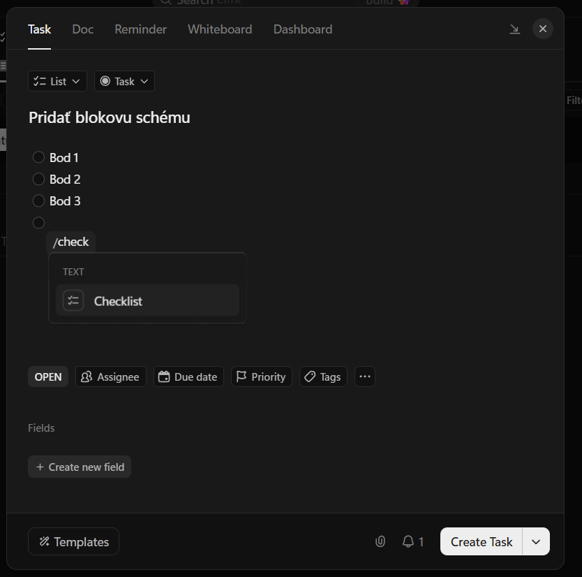

2. V **Assignees** vyber jedného riešiteľa, v **Due date** nastav dohodnutý termín a klikni na **Create Task**. Pri práci osamote si úlohu priraď sebe. Po otvorení skontroluj názov, popis, termín a riešiteľa.

   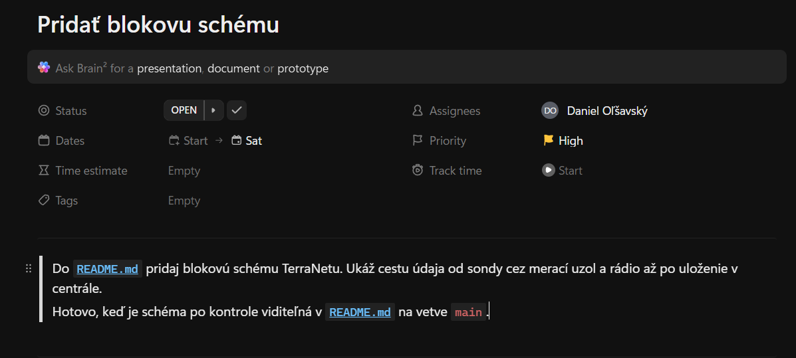

   [ClickUp Help – vytvorenie úlohy](https://help.clickup.com/hc/en-us/articles/6309647350807-Create-a-task)

</details>

<details>
<summary><strong>Začni pracovať</strong> · presuň kartu do In Progress</summary>

1. V zobrazení **List** vidíš úlohy, riešiteľov a termíny pod sebou.

   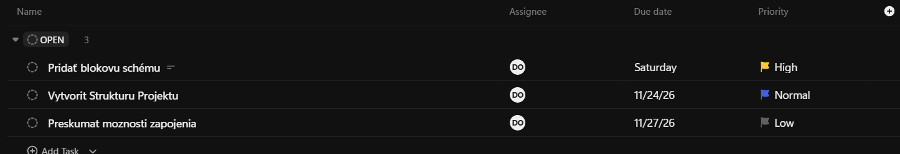

2. Prejdi na **Board**. Ak karta **Board** chýba, pridaj ju cez **+ View → Board**. Stĺpce zoskup podľa stavu (**Status**).

   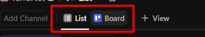

3. Chyť kartu **Pridať blokovú schému** a presuň ju z **Open** do **In Progress**. Nechaj ju tam, kým nebude výsledok skontrolovaný.

   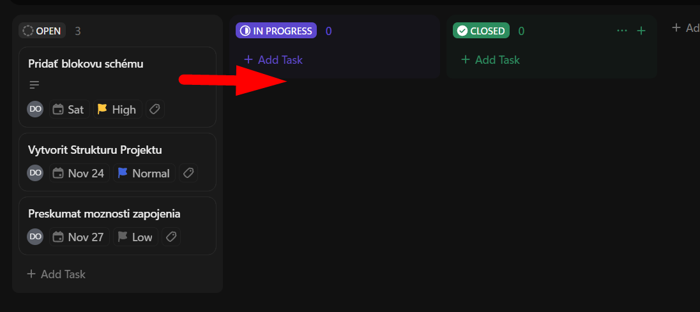

   [ClickUp Help – práca s nástenkou](https://help.clickup.com/hc/en-us/articles/6310080798615-Create-and-share-a-Board-view)

</details>

## Prvá zmena na GitHube

<details>
<summary><strong>Založ repozitár</strong> · preskoč, ak už tím repozitár má</summary>

1. Vpravo hore klikni na **+ → New repository**.

   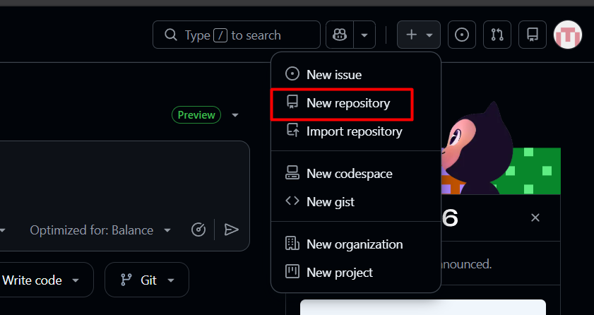

2. Ako názov zadaj **TerraNet**. Pre tímovú ukážku vyber **Private**, zapni **Add README** a klikni na **Create repository**. Ak bude pracovať viac ľudí, pozvi ich cez nastavenia repozitára a nechaj ich pozvánky prijať.

   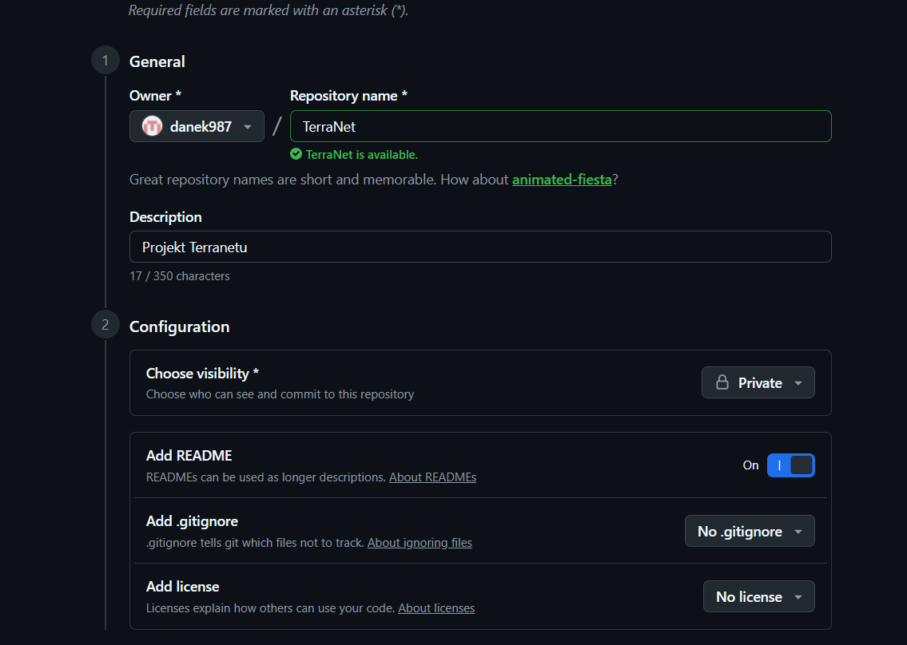

   [GitHub Docs – prvý repozitár](https://docs.github.com/en/get-started/using-github/hello-world)

</details>

<details>
<summary><strong>Vytvor vetvu a ulož zmenu</strong> · docs/blokova-schema</summary>

1. V karte **Code** otvor výber vetvy **main**. Napíš `docs/blokova-schema` a klikni na možnosť vytvorenia tejto vetvy z `main`. Pred úpravou skontroluj, že je vybratá nová vetva.

   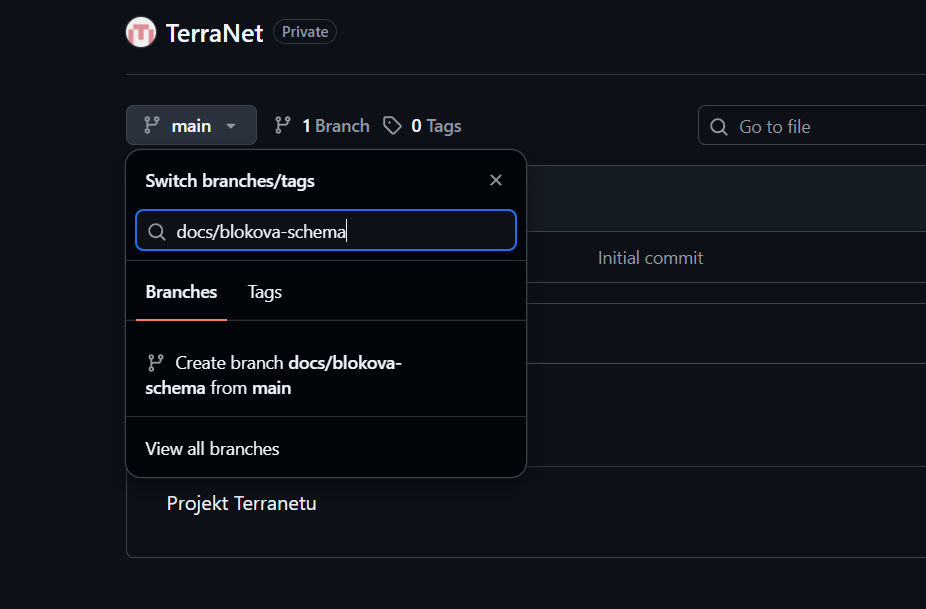

2. Otvor `README.md` a klikni na ceruzku **Edit this file**.

   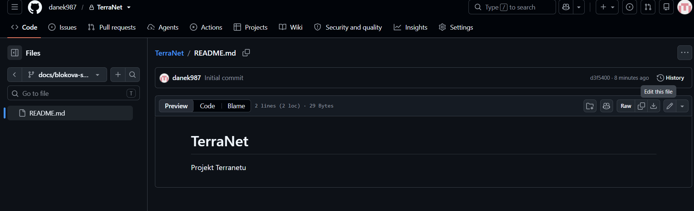

3. Pod existujúci úvod doplň:

   ```markdown
   ## Bloková schéma

   Sonda → merací uzol → rádio → centrála → uloženie údaja

   Centrála uloží čas prijatia, ID uzla a prijatú hodnotu.
   ```

   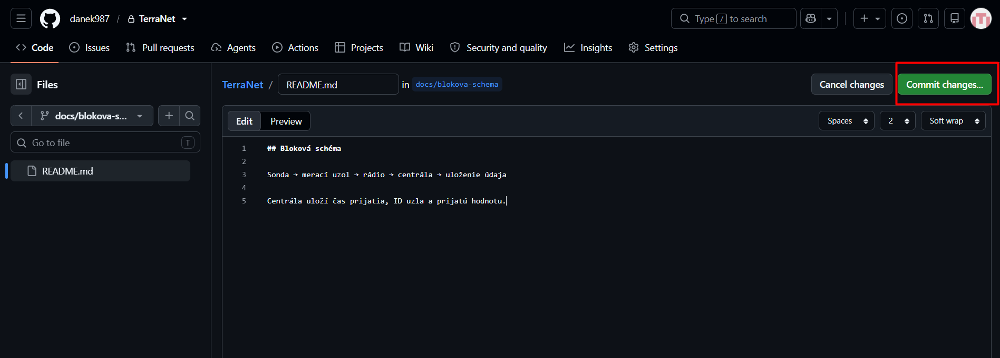

4. Klikni na **Commit changes**. Napíš správu `Pridaj blokovú schému TerraNetu`, nechaj vybranú vetvu `docs/blokova-schema` a potvrď **Commit changes**. Na snímke je ukážková správa `Update README.md`.

   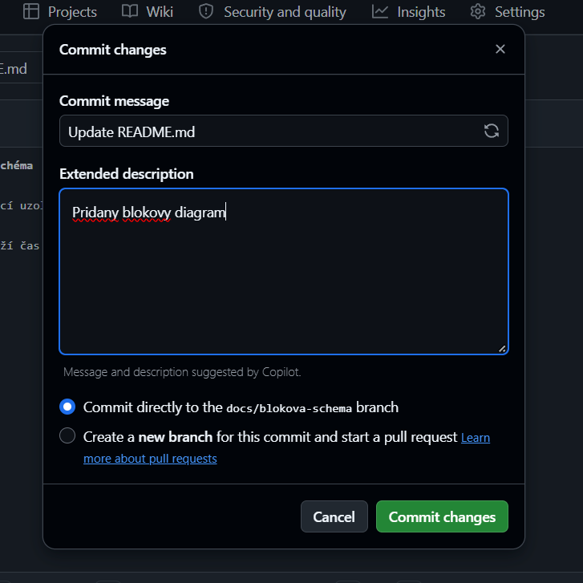

   [GitHub Docs – vetvy a commity](https://docs.github.com/en/get-started/using-github/hello-world)

</details>

<details>
<summary><strong>Otvor pull request a daj zmenu skontrolovať</strong></summary>

1. Prejdi na **Pull requests** a klikni na **Compare & pull request**. Ak sa výzva nezobrazuje, použi **New pull request**.

   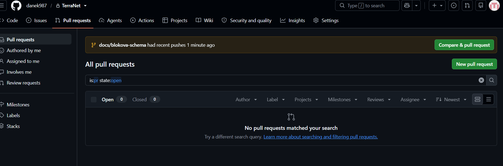

2. Nastav **base** na `main` a **compare** na `docs/blokova-schema`. Ako názov uveď **Pridať blokovú schému TerraNetu** a v popise stručne napíš, čo si pridal. Klikni na **Create pull request**.

   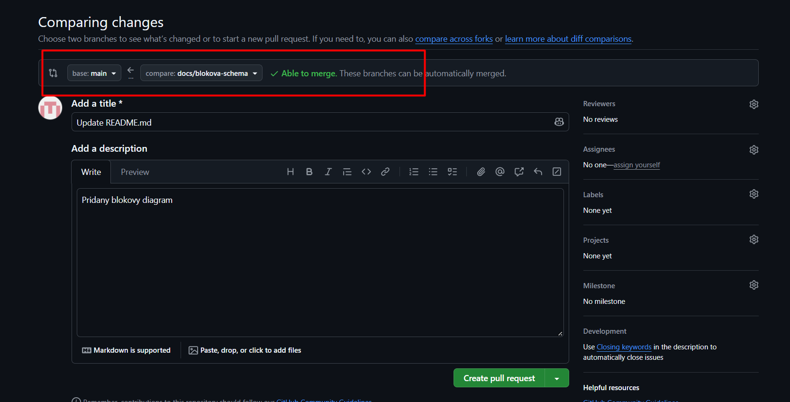

3. V časti **Reviewers** vyber spolužiaka s prístupom do repozitára. Popros ho, aby v **Files changed** skontroloval, či je v README celá cesta od sondy po uloženie. Spätnú väzbu môže odoslať cez **Review changes**. Pri samostatnom cvičení otvor **Files changed** a prejdi si rozdiel sám.

   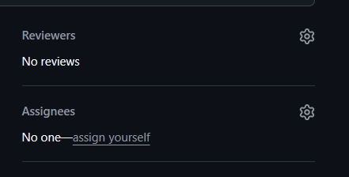

   [GitHub Docs – vytvorenie a kontrola pull requestu](https://docs.github.com/en/get-started/using-github/hello-world)

</details>

<details>
<summary><strong>Zlúč zmenu do main</strong> · po kontrole</summary>

1. Otvor kartu **Conversation**. Keď je zmena skontrolovaná a GitHub umožní zlúčenie, klikni na **Merge pull request** a potvrď **Confirm merge**. Ak vidíš **Resolve conflicts**, pokračuj podľa [postupu pri konflikte](#konflikt-v-readme) a potom sa vráť sem.

   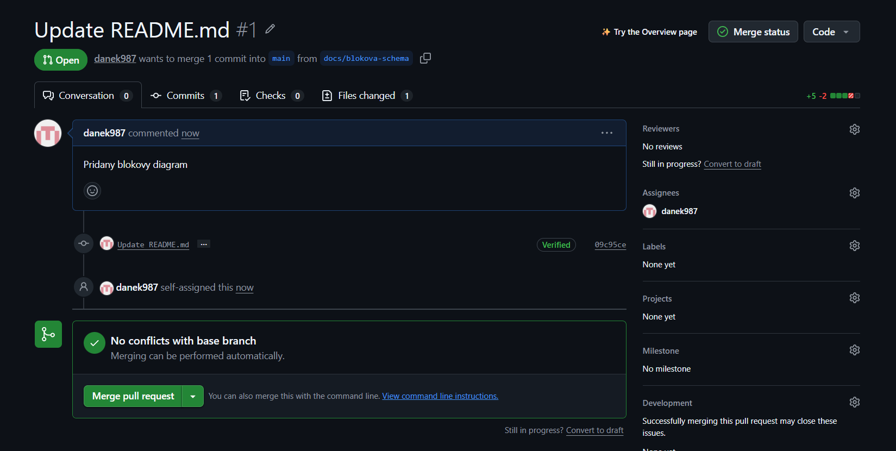

2. Po hlásení o úspešnom zlúčení otvor **Code → main → README.md** a skontroluj, že schéma je na hlavnej vetve. Skopíruj adresu zlúčeného pull requestu pre úlohu v ClickUpe.

   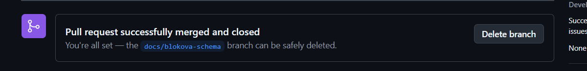

   [GitHub Docs – zlúčenie pull requestu](https://docs.github.com/en/get-started/using-github/hello-world)

</details>

## Konflikt v README

<details>
<summary><strong>Vyrieš konflikt v prehliadači</strong> · otvor iba pri hlásení o konflikte</summary>

Konflikt môže vzniknúť, keď niekto upraví rovnakú časť `README.md` aj na vetve `main`. GitHub potrebuje, aby ste rozhodli, ako má výsledný text vyzerať.

1. V pull requeste klikni na **Resolve conflicts**.

   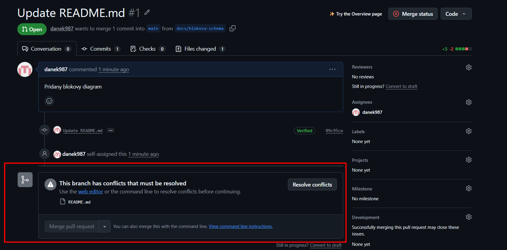

2. Porovnaj obe verzie. V tomto príklade je **Current change** z pracovnej vetvy a **Incoming change** z `main`. Uprav súbor tak, aby v ňom zostal pôvodný názov a úvod projektu aj nová schéma. Ak použiješ **Accept both changes**, skontroluj poradie nadpisov a odstráň nepotrebný skúšobný text. Značky `<<<<<<<`, `=======` a `>>>>>>>` po vyriešení v súbore nemajú zostať.

   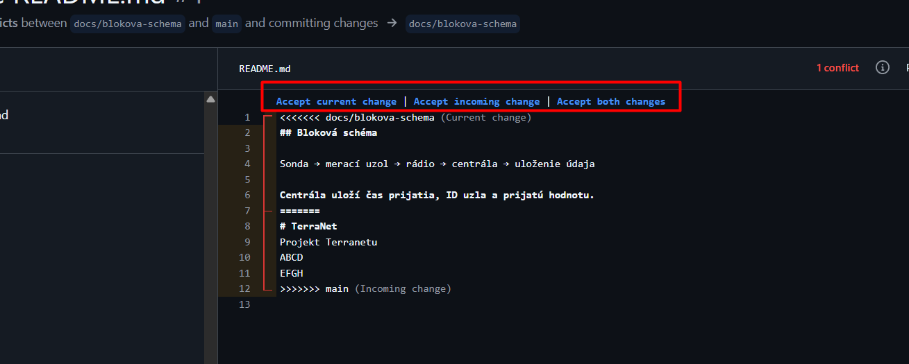

3. Klikni na **Mark as resolved** a potom na **Commit merge**. Tým uložíš vyriešenie do pracovnej vetvy. Vráť sa do pull requestu, skontroluj **Files changed** a dokonči zlúčenie do `main`.

   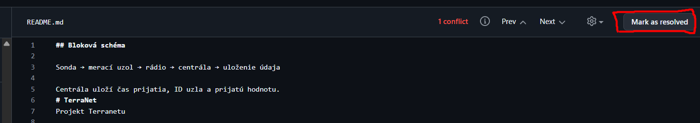

   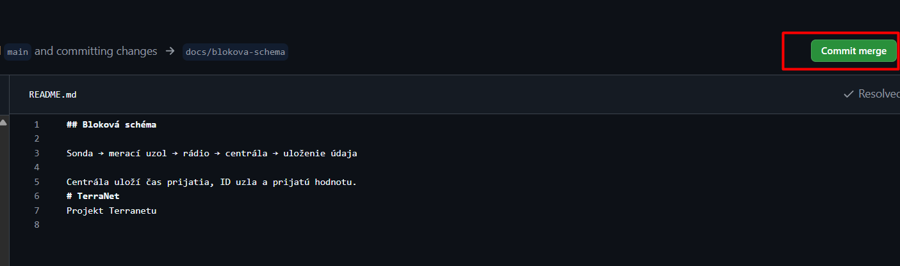

   [GitHub Docs – riešenie konfliktu na GitHube](https://docs.github.com/en/pull-requests/how-tos/merge-and-close-pull-requests/resolving-a-merge-conflict-on-github)

</details>

## Dokončenie úlohy v ClickUpe

<details>
<summary><strong>Pridaj výsledok a zavri kartu</strong></summary>

1. V úlohe **Pridať blokovú schému** pridaj komentár. Napíš „Schéma je v `README.md` na vetve `main`.“ Prilož adresu zlúčeného pull requestu, aby sa spolužiaci vedeli dostať k zmene.

   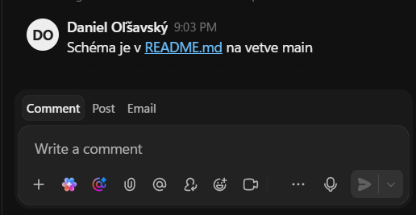

2. Keď overíš schému na vetve `main`, presuň kartu v **Board** do stĺpca **Closed**. V inom nastavení sa môže dokončený stav volať **Complete** alebo **Done**.

   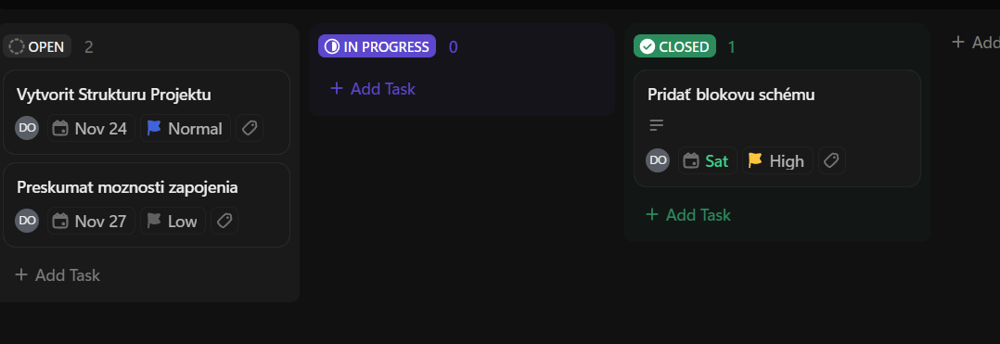

   [ClickUp Help – presúvanie úloh na nástenke](https://help.clickup.com/hc/en-us/articles/6310080798615-Create-and-share-a-Board-view)

</details>

## Ďalšie cvičenie pre tri skupiny

<details>
<summary><strong>Rozdeľte prvý skúšobný prenos</strong> · ukážkové úlohy do ClickUpu</summary>

Na stretnutí si dohodnite formát skúšobnej správy, napríklad `uzol-01,42`. V ClickUpe založte tri úlohy. Ku každej doplňte jedného riešiteľa, termín a podmienku dokončenia.

| Skupina | Úloha | Hotovo, keď |
| --- | --- | --- |
| Elektrikári | Zdokumentovať zapojenie skúšobného uzla | Pri úlohe je fotka alebo schéma použitého zapojenia s označenými pripojeniami. |
| Firmvér ESP32 | Odoslať skúšobný údaj | Prijímač zobrazí dohodnutú správu s ID uzla a skúšobnou hodnotou. |
| Web a databáza | Uložiť prijatý údaj | Skupina vie ukázať uložený záznam s časom prijatia, ID uzla a hodnotou. Príjem a uloženie môže najprv skúsiť so vzorovou správou. |

Na ďalšom stretnutí si ukážte cestu jednej správy od odoslania po uložený záznam.

</details>
