# ClickUp pre tím TerraNet

[Späť na úvod TerraNetu](../README.md)

Na úlohe **Pridať blokovú schému** si vyskúšaš zadanie, priradenie riešiteľa a termínu, presun na nástenke aj uzavretie úlohy. Keď je karta rozpracovaná, pokračuj [návodom na GitHub](../github/README.md) a potom sem vlož výsledok.

## Prístup do tímu

<strong>Prijmi pozvánku a nájdi úlohy TerraNetu</strong>

1. Otvor pozvánku z e-mailu a prihlás sa do ClickUpu účtom s pozvanou adresou. Ak použiješ **Pokračovať s Googlom**, vyber Google účet s touto adresou.

   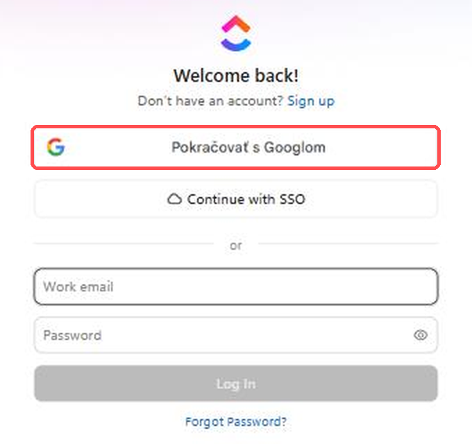

2. Vľavo hore vyber spoločný **Workspace** (pracovné prostredie tímu). V **Spaces** otvor priestor **TerraNet** a v ňom **List** (zoznam úloh). Jednotlivá položka je **Task**. **Board** zobrazí tie isté úlohy ako karty podľa stavu.

   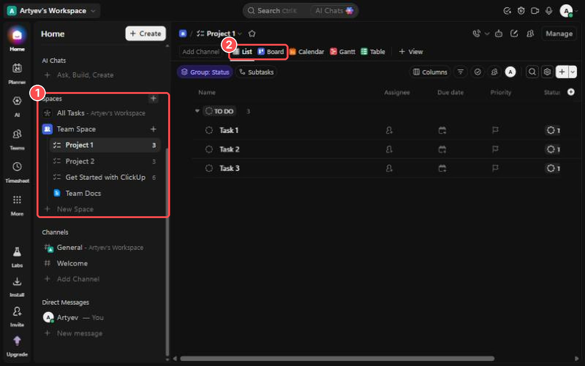

<strong>Pozvi spolužiakov</strong> · pre správcu pracovného prostredia

1. V paneli ClickUpu otvor **Invite**. Prípadne klikni na názov pracovného prostredia a otvor **People → Invite people**.
2. Zadaj e-mail spolužiaka, vyber dohodnutú rolu a odošli pozvánku. Rola **Member** dáva prístup k verejným položkám v pracovnom prostredí. Ak je **TerraNet** súkromný priestor, po prijatí pozvánky ho spolužiakovi sprístupni cez nastavenia zdieľania priestoru.

   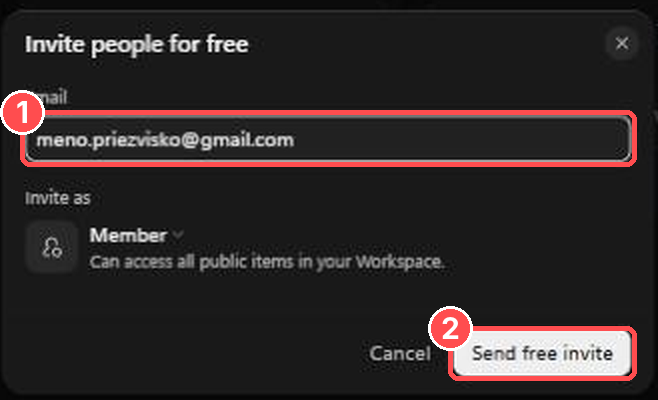

[ClickUp Help – pozvánky do pracovného prostredia](https://help.clickup.com/hc/en-us/articles/6310498173079-Invite-people-to-your-Workspace)

## Úlohy tímu v ClickUpe

<strong>Založ priestor TerraNet</strong> · pre človeka, ktorý nastavuje projekt

1. V bočnom paneli klikni na **+ Create → Space**.

   

2. Zadaj názov **TerraNet**. Ak má byť priestor dostupný len vybraným členom, zapni **Make Private** a cez **Add member** pridaj ľudí, ktorí v ňom budú pracovať. Potom klikni na **Continue**.

   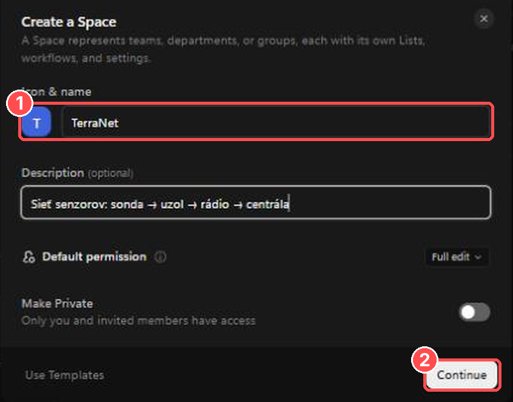

   

3. Vyber jednoduché nastavenie, napríklad **Starter**. V **Task statuses** môžeš vybrať šablónu **Normal**, aby si mal rovnaké stavy ako na nástenke v tomto návode. Klikni na **Create Space**.

   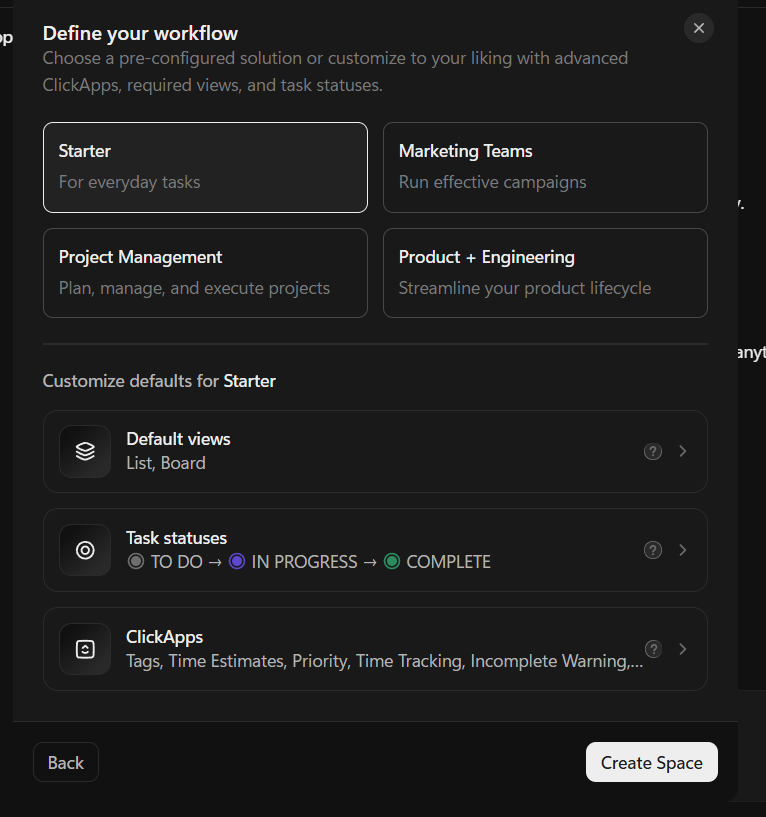

   

4. V priestore otvor existujúci zoznam úloh. Ak v ňom ešte žiadny nie je, klikni na **+** pri názve priestoru → **List**, zadaj **Prvý prototyp** a klikni na **Create**.

   [ClickUp Help – vytvorenie priestoru](https://help.clickup.com/hc/en-us/articles/6309390855319-Create-and-edit-Spaces) · [Vytvorenie zoznamu](https://help.clickup.com/hc/en-us/articles/33944215483159-Create-a-List)

<strong>Premenuj stavy po slovensky</strong> · voliteľné nastavenie priestoru

1. V bočnom paneli otvor **…** pri priestore **TerraNet** a vyber **Task statuses**.
2. V ponuke **…** pri jednotlivých stavoch premenuj **Open** na **Na spravenie**, **In Progress** na **Rozpracované** a **Closed** na **Hotovo**. Ponechaj ich v pôvodných skupinách a potvrď **Apply changes**. V návode uvidíš oba varianty názvov.

   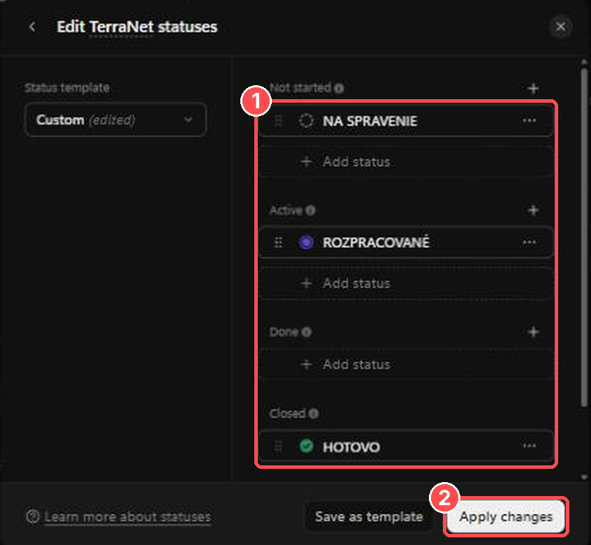

[ClickUp Help – nastavenie stavov](https://help.clickup.com/hc/en-us/articles/6309452618647-Manage-task-statuses)

<strong>Zadaj úlohu a priraď riešiteľa</strong> · Pridať blokovú schému

1. V zozname klikni na **+ Add Task** a zadaj názov **Pridať blokovú schému**. V popise uveď výsledok, ktorý má riešiteľ odovzdať:

   > Pridaj do `README.md` blokovú schému TerraNetu. Ukáž cestu údaja od sondy cez merací uzol a rádio až po uloženie v centrále.
   >
   > Hotovo, keď je schéma po kontrole viditeľná v `README.md` na vetve `main`.

   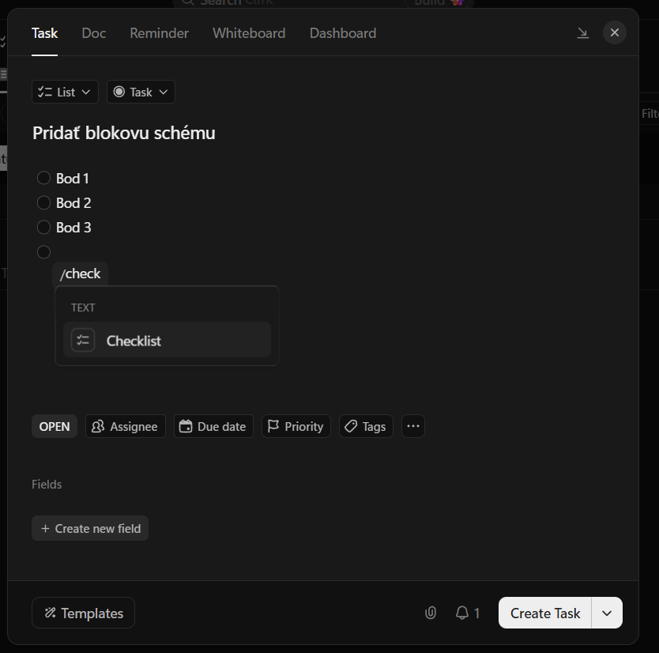

   Ak sa v zozname zobrazí krátky riadok s tlačidlom **Save**, ulož názov a potom otvor novú úlohu, aby si doplnil popis a ostatné polia.

   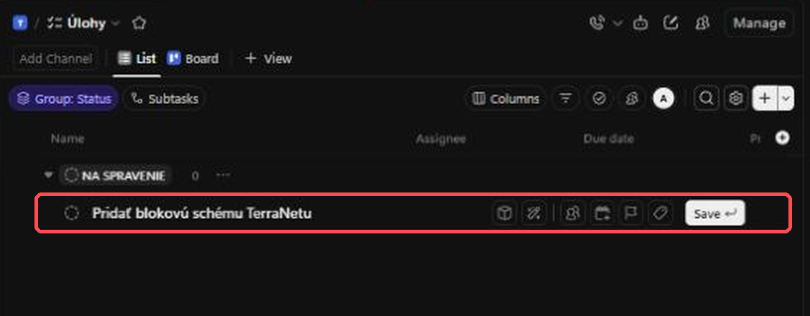

2. V **Assignees** vyber jedného riešiteľa a v **Due date** nastav dohodnutý termín. Pri práci osamote si úlohu priraď sebe. Ak tím používa **Priority**, nastav dohodnutú prioritu, napríklad **High**, ak od schémy závisí ďalšia úloha. Ak si ešte vo formulári, potvrď **Create Task**. Po otvorení úlohy skontroluj popis, termín a riešiteľa.

   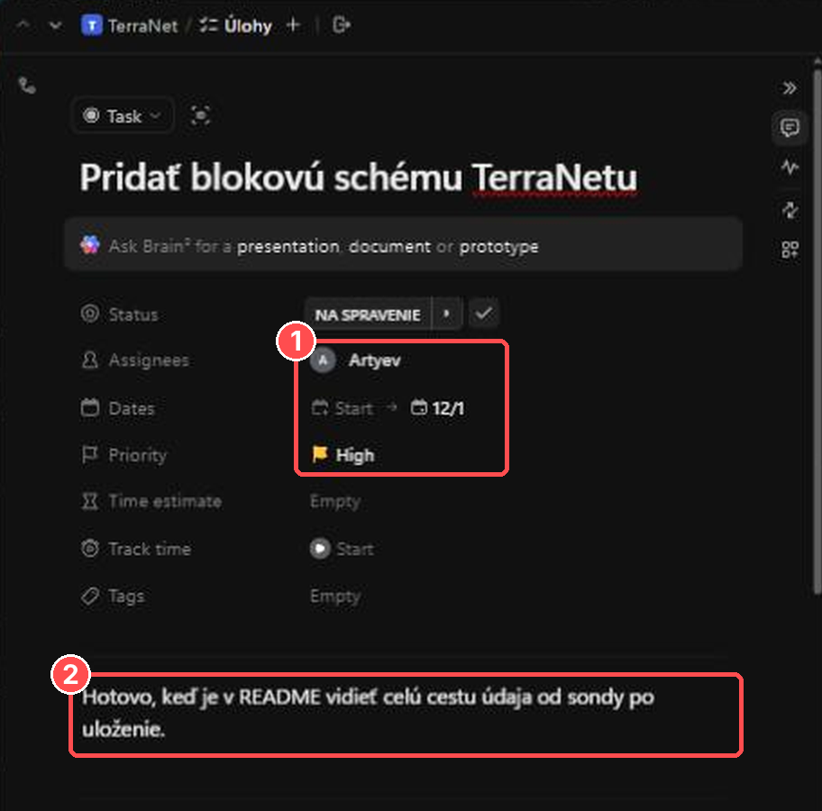

   [ClickUp Help – vytvorenie úlohy](https://help.clickup.com/hc/en-us/articles/6309647350807-Create-a-task)

<strong>Začni pracovať</strong> · presuň kartu do In Progress

1. V zobrazení **List** vidíš úlohy, riešiteľov a termíny pod sebou.

   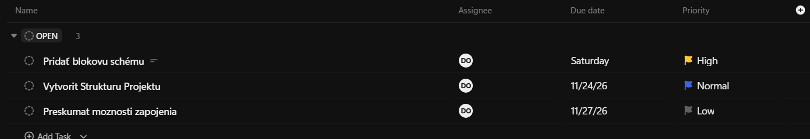

2. Prejdi na **Board**. Ak karta **Board** chýba, pridaj ju cez **+ View → Board**. Stĺpce zoskup podľa stavu (**Status**).

   

3. Chyť kartu **Pridať blokovú schému** a presuň ju z **Open** do **In Progress**. Nechaj ju tam, kým nebude výsledok skontrolovaný.

   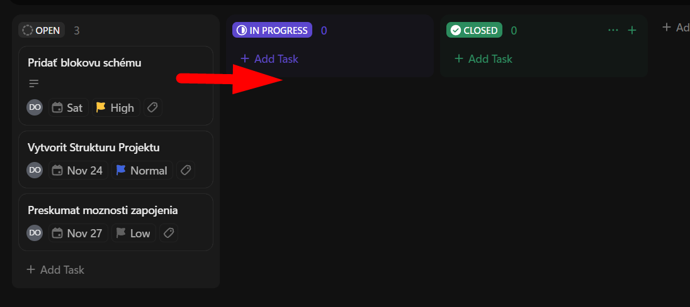

   [ClickUp Help – práca s nástenkou](https://help.clickup.com/hc/en-us/articles/6310080798615-Create-and-share-a-Board-view)

<strong>Zmeň stav priamo v úlohe</strong>

1. Otvor úlohu a klikni na názov aktuálneho stavu. Vyber **In Progress** alebo **Rozpracované**.
2. Šípka vedľa názvu posunie úlohu do nasledujúceho stavu. Fajka ju rovno uzavrie. Použi ju, keď je výsledok overený.

   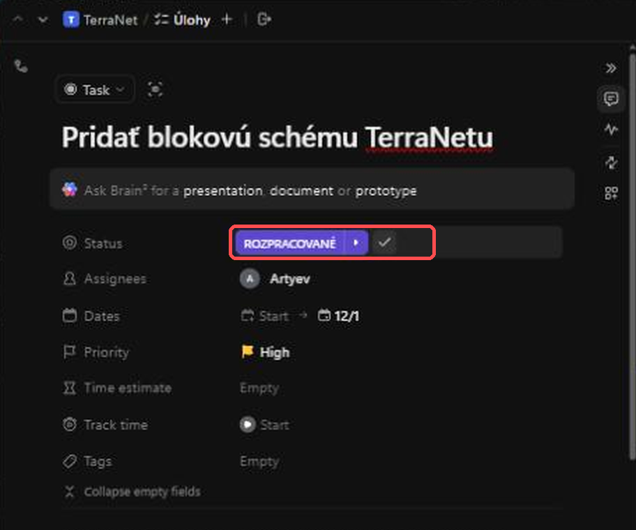

[ClickUp Help – zmena stavu úlohy](https://help.clickup.com/hc/en-us/articles/34958607300887-Use-statuses-on-tasks)

<strong>Napíš komentár, keď sa práca zasekne</strong>

1. V detaile úlohy otvor **Comments**. Napíš `@` a vyber spolužiaka, ktorý vie pomôcť.
2. Napíš, čo potrebuješ, napríklad „Chýba mi rozhodnutie, kde budeme ukladať merania. Vieš to potvrdiť?“ Komentár odošli.

   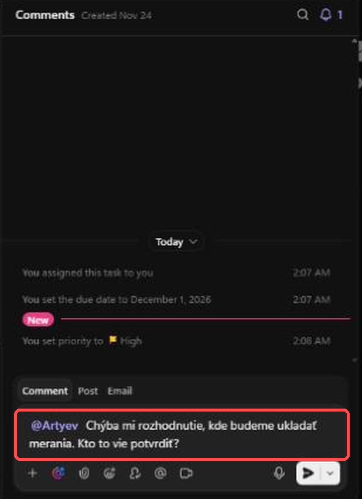

## Dokončenie úlohy v ClickUpe

<strong>Pridaj výsledok a zavri kartu</strong>

1. V úlohe **Pridať blokovú schému** pridaj komentár. Napíš „Schéma je v `README.md` na vetve `main`.“ Prilož adresu zlúčeného pull requestu, aby sa spolužiaci vedeli dostať k zmene.

   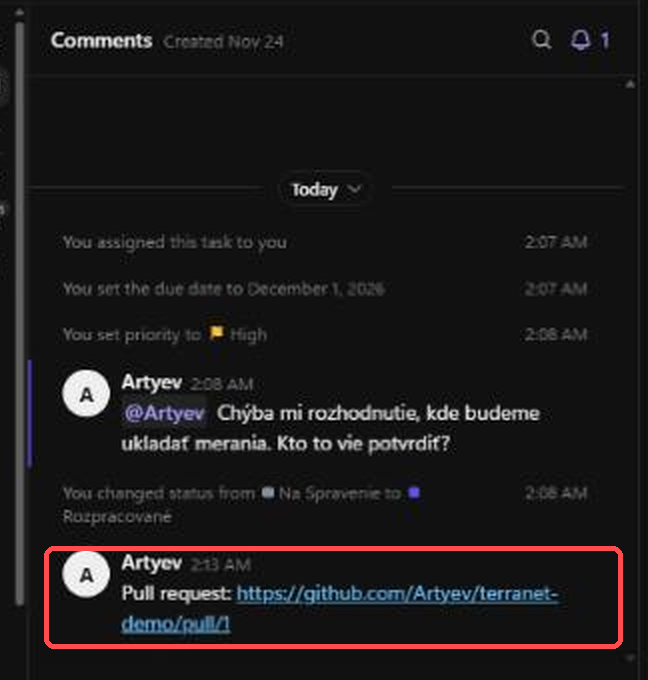

2. Keď overíš schému na vetve `main`, presuň kartu v **Board** do stĺpca **Closed** alebo **Hotovo**. V inom nastavení sa môže dokončený stav volať **Complete** alebo **Done**.

   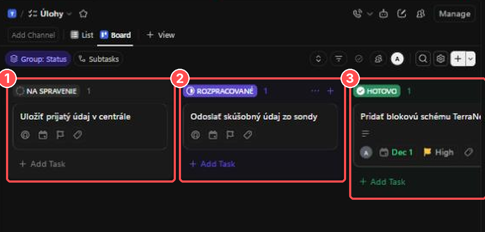

   [ClickUp Help – presúvanie úloh na nástenke](https://help.clickup.com/hc/en-us/articles/6310080798615-Create-and-share-a-Board-view)

