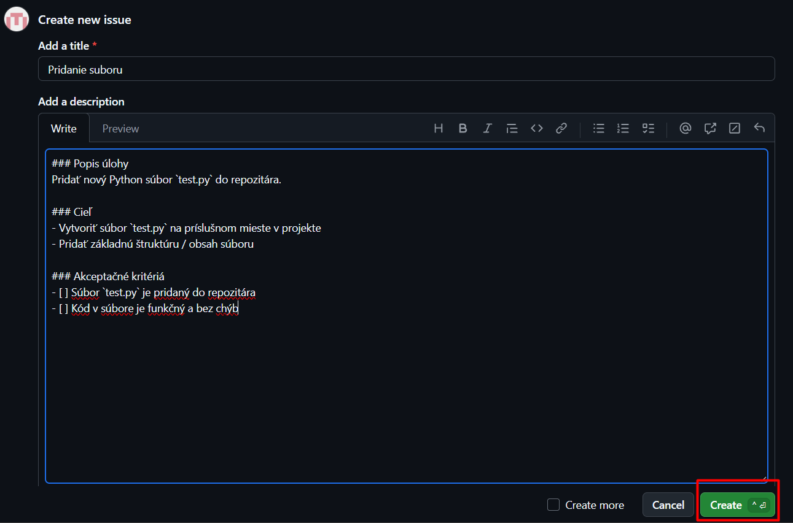
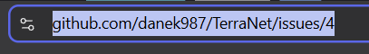
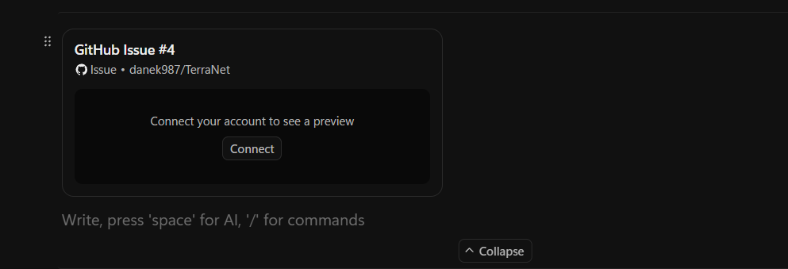
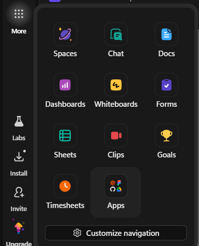
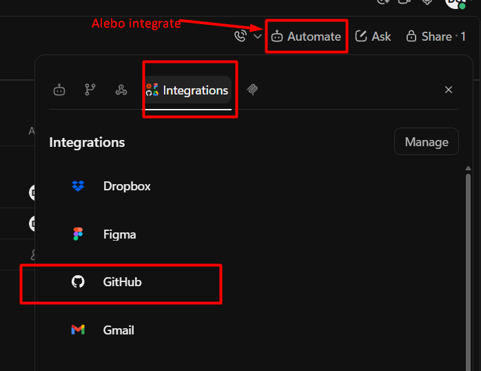
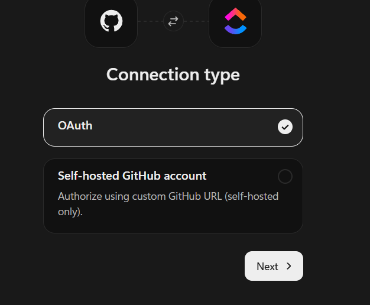
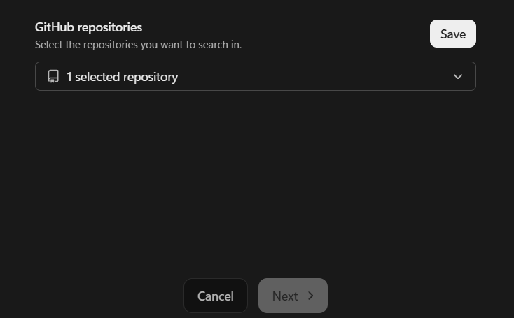
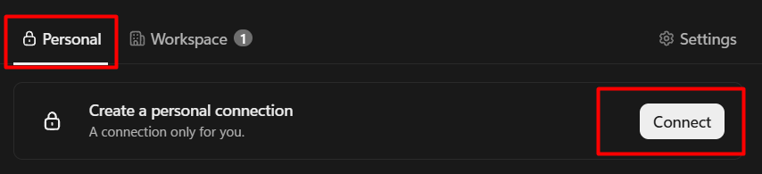

# GitHub Issue a prepojenie s ClickUpom

[Späť na návod na ClickUp](../README.md) · [Úvod TerraNetu](../../README.md)

Najprv vytvoríš Issue na GitHube a vložíš jeho odkaz do úlohy v ClickUpe. Ďalšie časti ukazujú nastavenie GitHub integrácie. Založenie úlohy nájdeš v [základnom návode na ClickUp](../README.md).

<strong>1. Založ Issue na GitHube</strong>

1. V tímovom repozitári otvor **Issues**.

2. Klikni na **New issue**.

3. Napíš názov, popis a podmienku dokončenia. Na snímke je úloha na pridanie súboru `test.py`. Použi zadanie dohodnuté vo vašom tíme a potvrď **Create**.

4. V **Assignees** vyber riešiteľa.

<strong>2. Vlož odkaz do úlohy v ClickUpe</strong>

1. Otvor vytvorené Issue a skopíruj adresu z prehliadača. Na snímke je Issue číslo 4, pri práci použi vlastnú adresu.

2. Vlož ju do popisu alebo komentára príslušnej úlohy v ClickUpe. Skontroluj, že odkaz otvorí správne Issue.

Na snímke karta žiada **Connect** na načítanie náhľadu. Člen tímu stále potrebuje prístup do súkromného repozitára.

3. V ponuke úlohy vyber **Copy link**. Tento odkaz môžeš vložiť späť do popisu Issue, aby sa dalo prejsť aj z GitHubu do ClickUpu.

<strong>3. Otvor nastavenie integrácie GitHubu</strong>

V ClickUpe otvor **More → Apps**, vyhľadaj GitHub a otvor ho.

V zobrazení na ďalšej snímke je vstup aj cez **Integrations → GitHub** pri úlohe.

<strong>4. Pripoj GitHub k pracovnému priestoru</strong>

Túto časť robí správca ClickUpu s príslušným prístupom do GitHub repozitára.

1. Na stránke integrácie vyber **Workspace → Connect**.

2. Pre účet na github.com ponechaj **OAuth**, klikni na **Next** a dokonči autorizáciu.

3. Pri nastavení vyhľadávania vyber repozitár, klikni na **Save** a dokonči sprievodcu.

4. Pre priradenie GitHub aktivity k úlohám ešte otvor **Settings → Add repo** a zvolený repozitár cez **+ Add Space** pripoj k priestoru **TerraNet**.

<strong>5. Pripoj vlastný účet a pokračuj s úlohou</strong>

Na stránke integrácie otvor **Personal → Connect** a dokonči prihlásenie do svojho GitHub účtu.

V úlohe v pripojenom priestore sa potom dá cez ikonu **GitHub → Add GitHub link → New GitHub Issue** vytvoriť nové Issue. Pri pull requeste môžeš v názve alebo popise uviesť ID ClickUp úlohy v tvare `CU-…` a následne skontrolovať jej **Activity**.

Použi skutočné ID úlohy zo svojho ClickUpu.

<strong>6. Prepoj opravu s Issue a dokonči úlohu</strong>

Ak pull request rieši Issue v rovnakom repozitári, do jeho popisu pridaj napríklad `Closes #4`. Číslo nahraď číslom vášho Issue. Po zlúčení do predvolenej vetvy GitHub toto Issue automaticky uzavrie.

Do úlohy v ClickUpe vlož odkaz na pull request a po overení výsledku ju uzavri. Pre kontrolu zmeny použi [návod na review](../../github/review/README.md).

[GitHub – prepojenie pull requestu s Issue](https://docs.github.com/en/issues/tracking-your-work-with-issues/using-issues/linking-a-pull-request-to-an-issue)

[ClickUp – integrácia s GitHubom](https://help.clickup.com/hc/en-us/articles/6305771568791-GitHub-integration)
