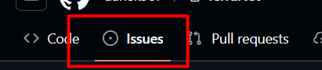
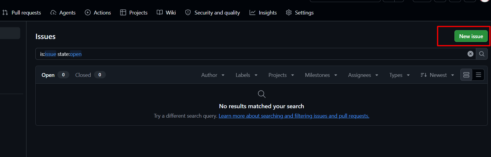
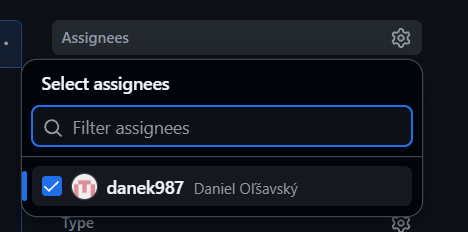
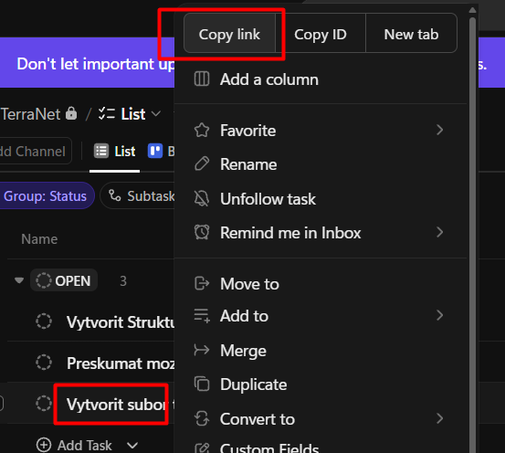
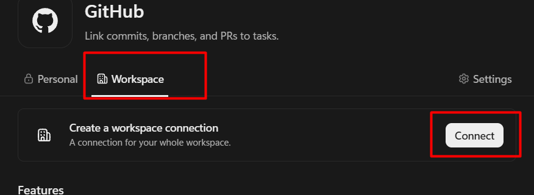
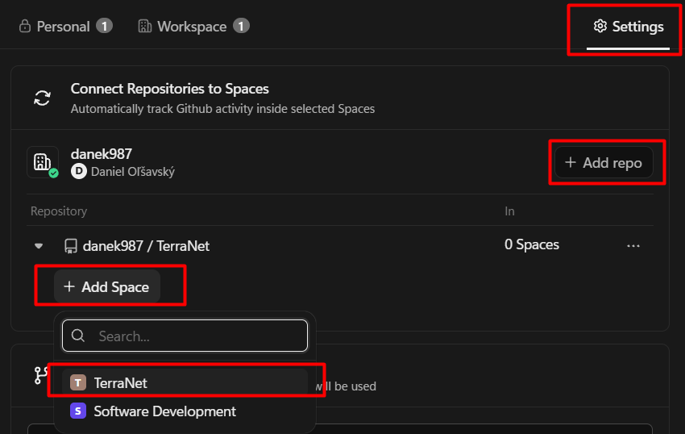
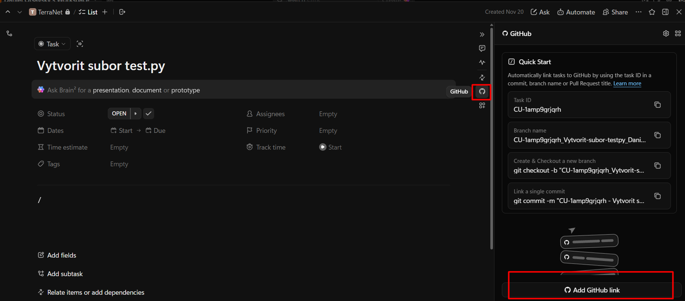
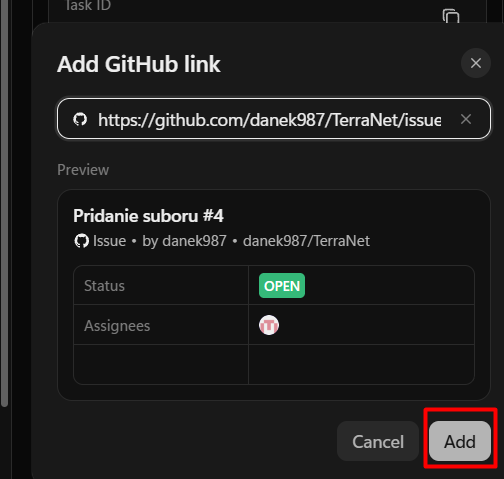
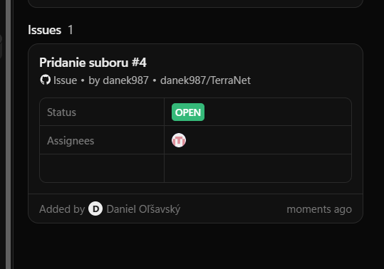

# GitHub Issue a prepojenie s ClickUpom

[Späť na návod na ClickUp](../README.md) · [Úvod TerraNetu](../../README.md)

Vyber si jednu z dvoch možností. Pri **ručnom prepojení** vložíš odkazy do popisov. Pri **prepojení cez integráciu** pridáš Issue do GitHub panela úlohy a uvidíš pri ňom stav aj riešiteľa. Založenie úlohy nájdeš v [základnom návode na ClickUp](../README.md).

## Možnosť 1 – ručné prepojenie odkazmi

<strong>1. Založ Issue na GitHube</strong>

1. V tímovom repozitári otvor **Issues**.

2. Klikni na **New issue**.

3. Napíš názov, popis a podmienku dokončenia. Na snímke je úloha na pridanie súboru `test.py`. Použi zadanie dohodnuté vo vašom tíme a potvrď **Create**.

4. V **Assignees** vyber riešiteľa.

<strong>2. Vlož odkazy do ClickUpu a GitHubu</strong>

1. Otvor vytvorené Issue a skopíruj adresu z prehliadača. Na snímke je Issue číslo 4, pri práci použi vlastnú adresu.

2. Vlož ju do popisu alebo komentára príslušnej úlohy v ClickUpe. Skontroluj, že odkaz otvorí správne Issue.

Na snímke karta žiada **Connect** na načítanie náhľadu. Člen tímu stále potrebuje prístup do súkromného repozitára.

3. V ponuke úlohy vyber **Copy link**. Tento odkaz môžeš vložiť späť do popisu Issue, aby sa dalo prejsť aj z GitHubu do ClickUpu.

## Možnosť 2 – prepojenie cez integráciu GitHubu

Ak už máš GitHub účet aj repozitár pripojené k priestoru TerraNet, pokračuj krokom **5. Pridaj existujúce Issue do tasku**.

<strong>1. Otvor nastavenie integrácie</strong>

V ClickUpe otvor **More → Apps**, vyhľadaj GitHub a otvor ho.

V zobrazení na ďalšej snímke je vstup aj cez **Integrations → GitHub** pri úlohe.

<strong>2. Pripoj pracovný priestor ku GitHubu</strong>

Túto časť robí správca ClickUpu s príslušným prístupom do GitHub repozitára.

1. Na stránke integrácie vyber **Workspace → Connect**.

2. Pre účet na github.com ponechaj **OAuth**, klikni na **Next** a dokonči autorizáciu.

3. Pri nastavení vyhľadávania vyber repozitár, klikni na **Save** a dokonči sprievodcu.

<strong>3. Pripoj repozitár k priestoru TerraNet</strong>

V **Settings** klikni na **Add repo** a vyber tímový repozitár, napríklad **danek987/TerraNet**.

Rozbaľ riadok repozitára, klikni na **Add Space** a vyber **TerraNet**. Pri repozitári sa má zobraziť priradený priestor.

Týmto krokom sprístupníš GitHub panel v úlohách tohto priestoru.

<strong>4. Pripoj vlastný GitHub účet</strong>

Na stránke integrácie otvor **Personal → Connect** a dokonči prihlásenie do svojho GitHub účtu.

<strong>5. Pridaj existujúce Issue do tasku</strong>

1. Otvor task v ClickUpe, napríklad **Vytvorit subor test.py**. Vpravo klikni na ikonu **GitHub**, potom dole na **Add GitHub link**.

2. Vlož adresu existujúceho Issue z GitHubu. Počkaj na náhľad a skontroluj názov, číslo aj repozitár. Potom klikni na **Add**.

3. V časti **Issues** už uvidíš pripojené Issue, jeho stav a riešiteľa. Na snímke je **Pridanie suboru #4**.

<strong>Voliteľne. Vytvor nové Issue alebo priraď aktivitu</strong>

Nové Issue môžeš vytvoriť priamo z tasku cez **GitHub → Add GitHub link → New GitHub Issue**.

Pri pull requeste, vetve alebo commite môže integrácia priradiť aktivitu automaticky podľa ID ClickUp úlohy v tvare `CU-…`. ID skopíruj z GitHub panela tasku a použi ho napríklad v popise pull requestu. V tasku potom skontroluj **Activity**.

## Dokončenie práce

<strong>Prepoj opravu s Issue a dokonči úlohu</strong>

Ak pull request rieši Issue v rovnakom repozitári, do jeho popisu pridaj napríklad `Closes #4`. Číslo nahraď číslom vášho Issue. Po zlúčení do predvolenej vetvy GitHub toto Issue automaticky uzavrie.

Do úlohy v ClickUpe vlož odkaz na pull request a po overení výsledku ju uzavri. Pre kontrolu zmeny použi [návod na review](../../github/review/README.md).

[GitHub – prepojenie pull requestu s Issue](https://docs.github.com/en/issues/tracking-your-work-with-issues/using-issues/linking-a-pull-request-to-an-issue)

[ClickUp – integrácia s GitHubom](https://help.clickup.com/hc/en-us/articles/6305771568791-GitHub-integration)
