# GitHub pre tím TerraNet

[Späť na úvod TerraNetu](../README.md)

V prehliadači pridáš blokovú schému do spoločného repozitára. Vytvoríš vetvu, uložíš zmenu, otvoríš pull request a po kontrole ju zlúčiš do hlavnej vetvy. Ak už máte zadanie v ClickUpe, po zlúčení ho [uzavri podľa postupu](../clickup/README.md#dokončenie-úlohy-v-clickupe).

## Prvá zmena na GitHube

<details markdown="block">
<summary><strong>Založ repozitár</strong> · preskoč, ak už tím repozitár má</summary>

1. Vpravo hore klikni na **+ → New repository**.

   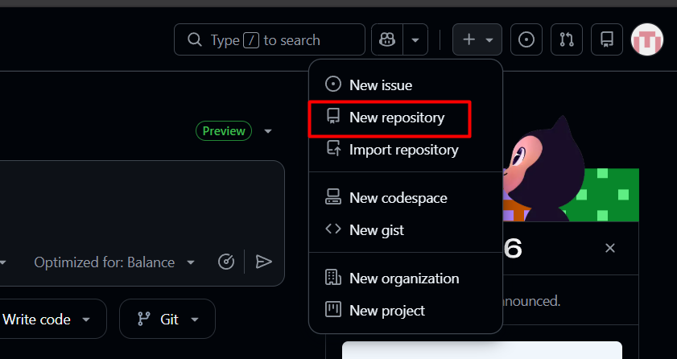

2. Ako názov zadaj **TerraNet**. Pre tímovú ukážku vyber **Private**, zapni **Add README** a klikni na **Create repository**.

   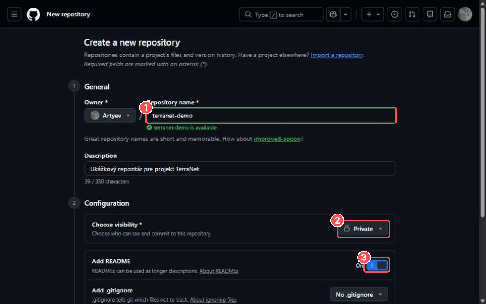

   [GitHub Docs – prvý repozitár](https://docs.github.com/en/get-started/using-github/hello-world)

</details>

<details markdown="block">
<summary><strong>Pozvi spolužiakov do repozitára</strong> · pre vlastníka osobného repozitára</summary>

1. Otvor repozitár a prejdi na jeho **Settings → Collaborators** v časti **Access**.
2. Klikni na **Add people**, vyhľadaj GitHub meno spolužiaka a potvrď pozvánku.

   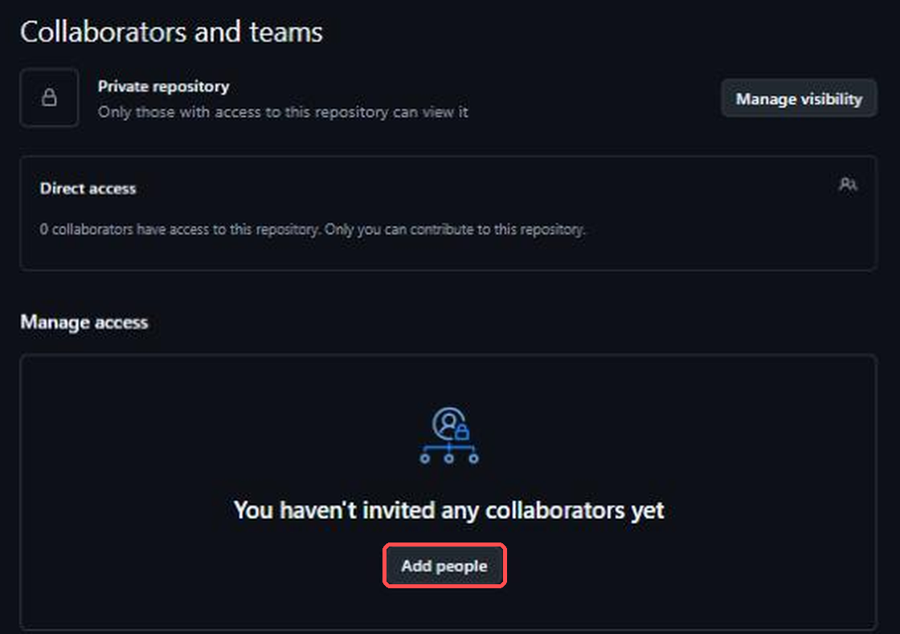

3. Spolužiak prijme pozvánku a overí, či vidí tímový repozitár.

[GitHub Docs – pozvanie spolupracovníkov](https://docs.github.com/en/repositories/managing-your-repositorys-settings-and-features/repository-access-and-collaboration/inviting-collaborators-to-a-personal-repository)

</details>

<details markdown="block">
<summary><strong>Vytvor vetvu a ulož zmenu</strong> · docs/blokova-schema</summary>

1. V karte **Code** otvor výber vetvy **main**. Napíš `docs/blokova-schema` a klikni na možnosť vytvorenia tejto vetvy z `main`. Pred úpravou skontroluj, že je vybratá nová vetva.

   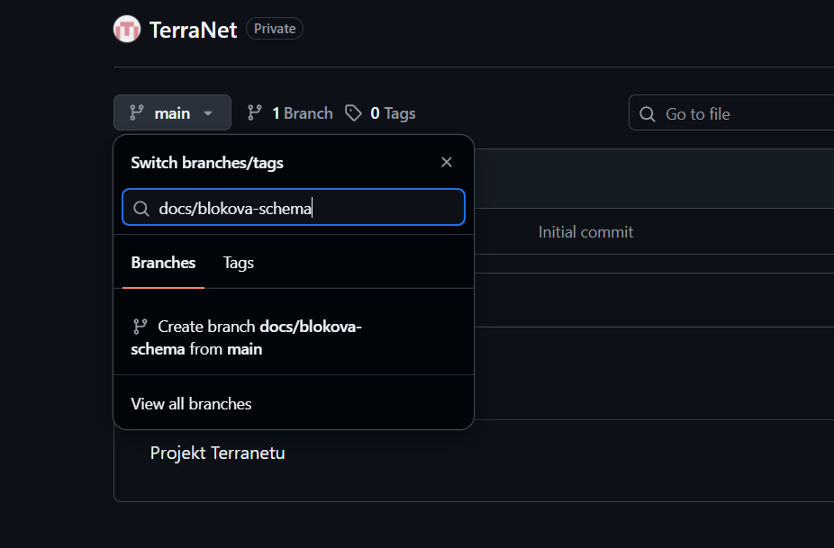

2. Otvor `README.md` a klikni na ceruzku **Edit this file**.

   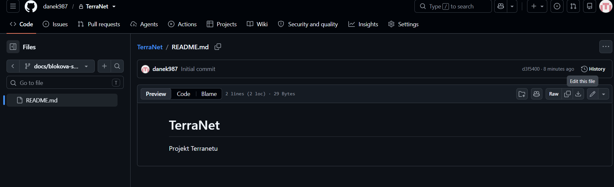

3. Pod existujúci úvod doplň:

   ```markdown
   ## Bloková schéma

   Sonda → merací uzol → rádio → centrála → uloženie údaja

   Centrála uloží čas prijatia, ID uzla a prijatú hodnotu.
   ```

   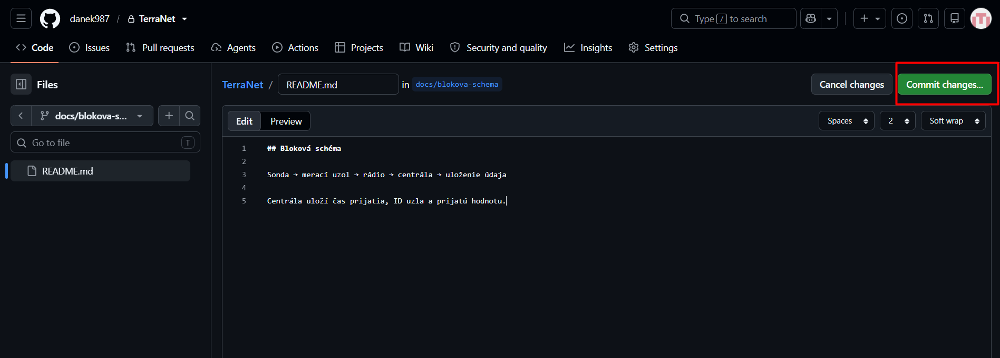

4. Klikni na **Commit changes**. Napíš správu `Pridaj blokovú schému TerraNetu`, nechaj vybranú vetvu `docs/blokova-schema` a potvrď **Commit changes**. Na snímke je ukážková správa `Update README.md`.

   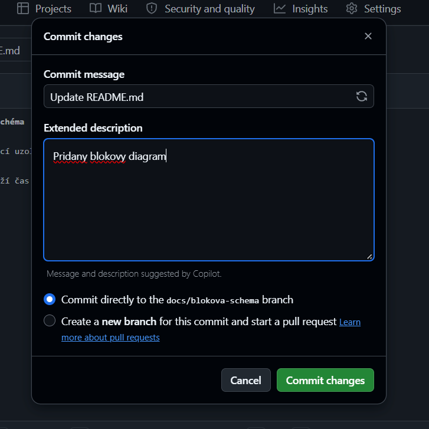

   [GitHub Docs – vetvy a commity](https://docs.github.com/en/get-started/using-github/hello-world)

</details>

<details markdown="block">
<summary><strong>Otvor pull request a daj zmenu skontrolovať</strong></summary>

1. Prejdi na **Pull requests** a klikni na **Compare & pull request**. Ak sa výzva nezobrazuje, použi **New pull request**.

   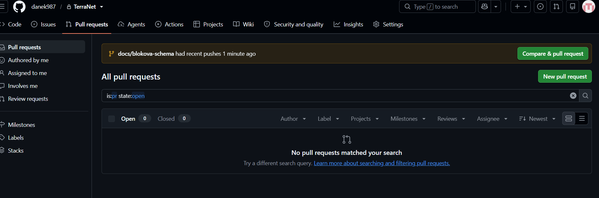

2. Nastav **base** na `main` a **compare** na `docs/blokova-schema`. Ako názov uveď **Pridať blokovú schému TerraNetu** a v popise stručne napíš, čo si pridal. Klikni na **Create pull request**.

   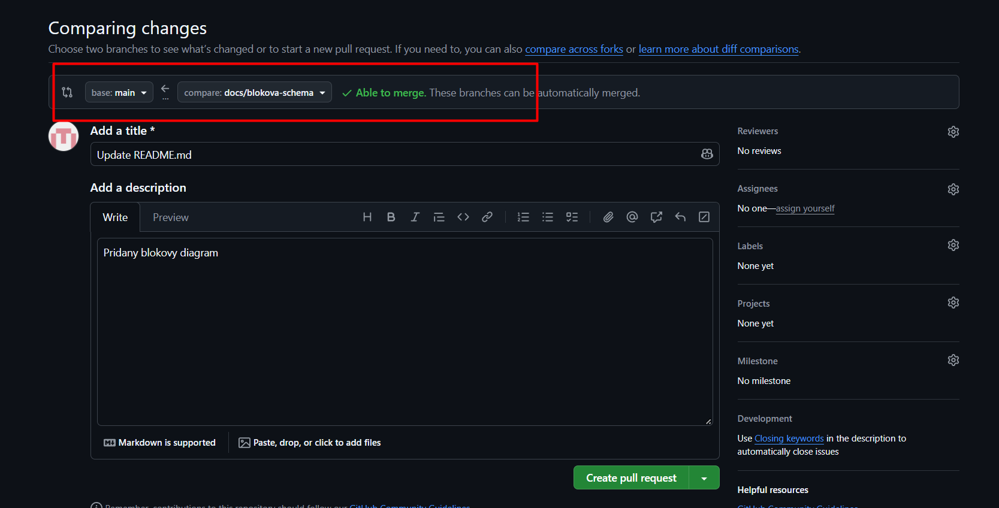

3. V časti **Reviewers** vyber spolužiaka s prístupom do repozitára. Popros ho, aby v **Files changed** skontroloval, či je v README celá cesta od sondy po uloženie. Spätnú väzbu môže odoslať cez **Review changes**. Pri samostatnom cvičení otvor **Files changed** a prejdi si rozdiel sám.

   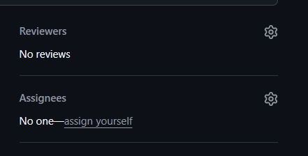

   [GitHub Docs – vytvorenie a kontrola pull requestu](https://docs.github.com/en/get-started/using-github/hello-world)

</details>

<details markdown="block">
<summary><strong>Zlúč zmenu do main</strong> · po kontrole</summary>

1. Otvor kartu **Conversation**. Keď je zmena skontrolovaná a GitHub umožní zlúčenie, klikni na **Merge pull request** a potvrď **Confirm merge**. Ak vidíš **Resolve conflicts**, pokračuj podľa [postupu pri konflikte](#konflikt-v-readme) a potom sa vráť sem.

   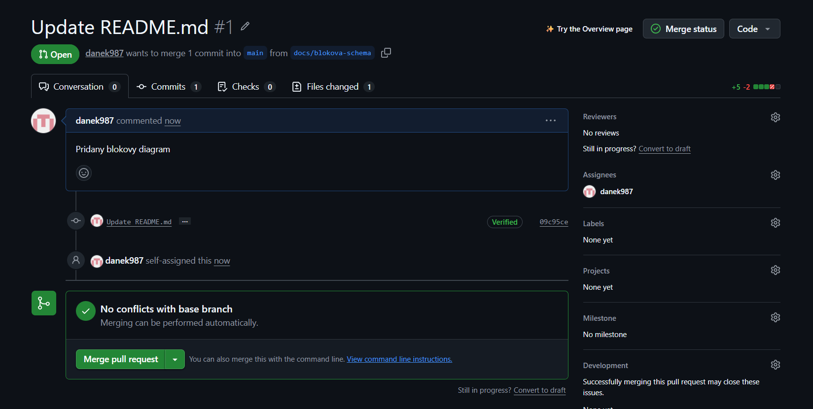

2. Po hlásení o úspešnom zlúčení otvor **Code → main → README.md** a skontroluj, že schéma je na hlavnej vetve. Skopíruj adresu zlúčeného pull requestu pre úlohu v ClickUpe.

   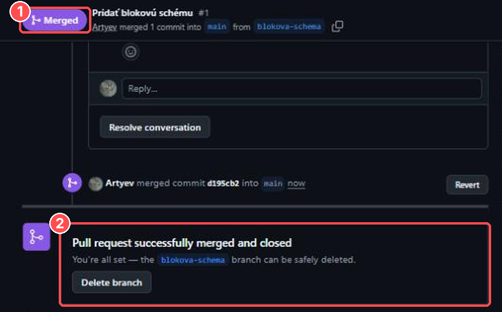

   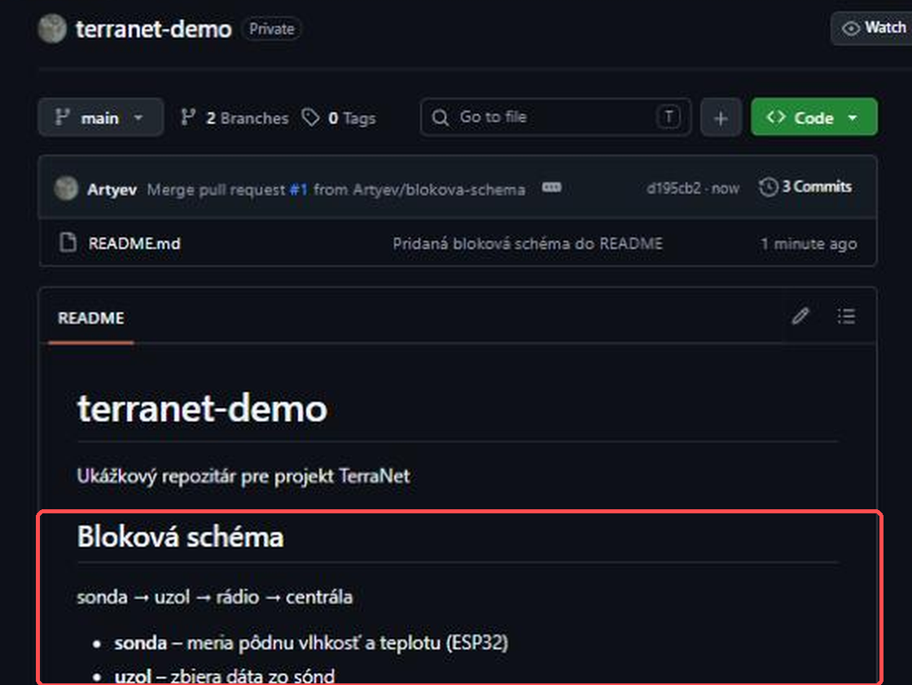

   [GitHub Docs – zlúčenie pull requestu](https://docs.github.com/en/get-started/using-github/hello-world)

</details>

Ak chceš tú istú zmenu robiť na počítači, použi [návod na Git v termináli](terminal/README.md).

## Konflikt v README

<details markdown="block">
<summary><strong>Vyrieš konflikt v prehliadači</strong> · otvor iba pri hlásení o konflikte</summary>

Konflikt môže vzniknúť, keď niekto upraví rovnakú časť `README.md` aj na vetve `main`. GitHub potrebuje, aby ste rozhodli, ako má výsledný text vyzerať.

1. V pull requeste klikni na **Resolve conflicts**.

   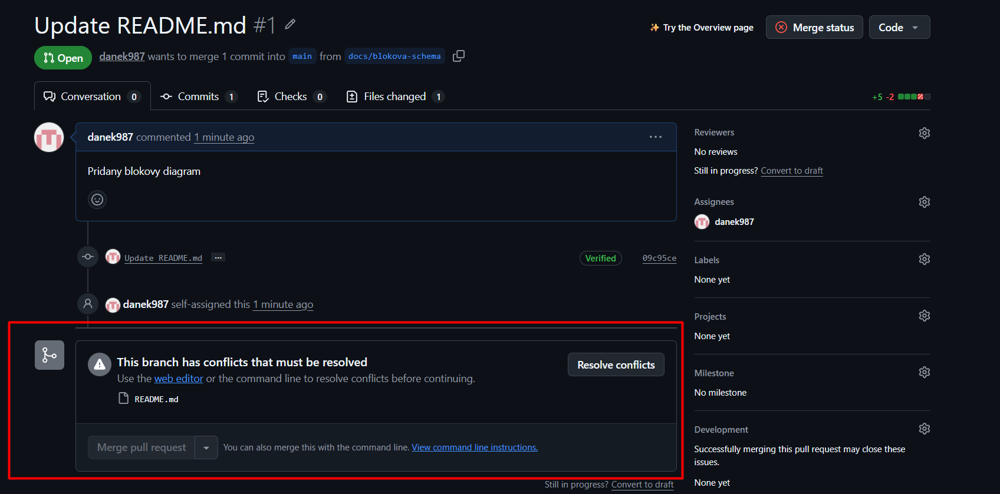

2. Porovnaj obe verzie. V tomto príklade je **Current change** z pracovnej vetvy a **Incoming change** z `main`. Uprav súbor tak, aby v ňom zostal pôvodný názov a úvod projektu aj nová schéma. Ak použiješ **Accept both changes**, skontroluj poradie nadpisov a odstráň nepotrebný skúšobný text. Značky `<<<<<<<`, `=======` a `>>>>>>>` po vyriešení v súbore nemajú zostať.

   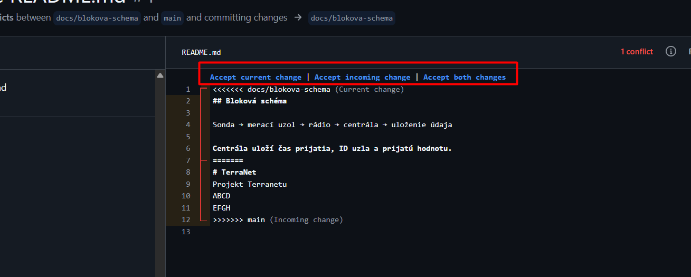

3. Klikni na **Mark as resolved** a potom na **Commit merge**. Tým uložíš vyriešenie do pracovnej vetvy. Vráť sa do pull requestu, skontroluj **Files changed** a dokonči zlúčenie do `main`.

   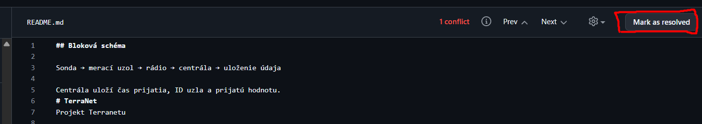

   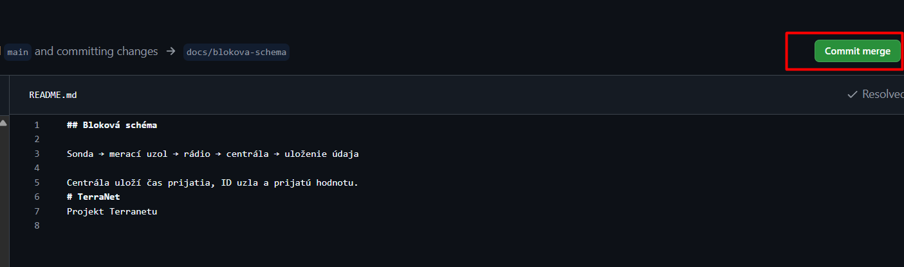

   [GitHub Docs – riešenie konfliktu na GitHube](https://docs.github.com/en/pull-requests/how-tos/merge-and-close-pull-requests/resolving-a-merge-conflict-on-github)

</details>
