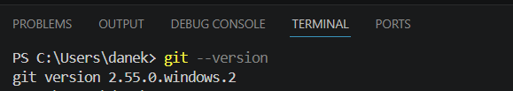
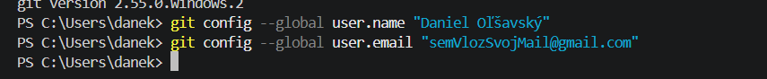
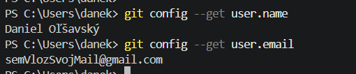

# Inštalácia a nastavenie Gitu

[Späť na návody pre GitHub](../README.md) · [Úvod TerraNetu](../../README.md)

Postup pre Windows pred prvou prácou vo VS Code alebo PyCharme. Git nainštaluješ do počítača a editor ho potom používa. Kroky rozbaľuj postupne.

<details markdown="block">
<summary><strong>1. Nainštaluj Git a over verziu</strong></summary>

Stiahni a spusti inštalátor z [Git for Windows](https://git-scm.com/install/win). Pri voľbe použitia z príkazového riadka ponechaj možnosť sprístupniť Git aj ostatným programom.

Ak používaš `winget`, môžeš inštaláciu spustiť z PowerShellu:

```powershell
winget install --id Git.Git -e --source winget
```

Po inštalácii zatvor a znova otvor editor. Vo VS Code otvor **Terminal → New Terminal** a zadaj:

```powershell
git --version
```



Číslo verzie potvrdzuje, že editor vie Git spustiť. Ak príkaz nepozná ani po reštarte editora, over ho v novom PowerShelli a skontroluj inštaláciu Gitu.

</details>

<details markdown="block">
<summary><strong>2. Nastav svoje meno a e-mail</strong></summary>

Do terminálu zadaj nasledujúce príkazy. Text v úvodzovkách nahraď vlastnými údajmi:

```powershell
git config --global user.name "Tvoje meno"
git config --global user.email "SEM_VLOZ_SVOJ_EMAIL"
```



Použi e-mail overený v účte GitHub alebo presnú adresu `noreply` z **GitHub → Settings → Emails**. Na snímke je ukážková adresa, pri cvičení doplň vlastnú.

Tieto údaje sa zapíšu k novým commitom ako autor. Ku GitHubu sa následne prihlásiš cez prehliadač.

`--global` nastaví predvolené údaje pre tvoj používateľský účet v počítači. Pre konkrétny projekt môžeš v jeho priečinku použiť `--local`:

```powershell
git config --local user.name "Tvoje meno"
git config --local user.email "SEM_VLOZ_SVOJ_EMAIL"
```

</details>

<details markdown="block">
<summary><strong>3. Skontroluj nastavenie a vyber editor</strong></summary>

V termináli spusti:

```powershell
git config --get user.name
git config --get user.email
```



Keď vidíš svoje údaje, pokračuj [návodom pre VS Code](../vscode-github/README.md) alebo [návodom pre PyCharm](../pycharm-github/README.md).

</details>

[VS Code – nastavenie Gitu](https://code.visualstudio.com/docs/sourcecontrol/quickstart) · [GitHub – e-mail pre commity](https://docs.github.com/en/account-and-profile/how-tos/email-preferences/setting-your-commit-email-address)
