# GitHub v PyCharme

[Späť na návody pre GitHub](../README.md) · [Úvod TerraNetu](../../README.md)

Postup od stiahnutia tímového repozitára po odoslanie zmeny a aktualizáciu projektu. Pred začiatkom [nainštaluj Git a nastav meno s e-mailom](../git-vscode/README.md). Tím ti pridelí prístup do repozitára. V PyCharme over Git cez **Settings → Version Control → Git → Test**.

<strong>1. Naklonuj repozitár a prihlás sa</strong>

1. Na úvodnej obrazovke PyCharmu klikni na **Clone Repository**.

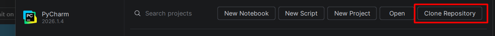

2. Do **URL** vlož HTTPS adresu tímového projektu z **GitHub → Code → HTTPS**. Skontroluj lokálny priečinok **Directory** a klikni na **Clone**.

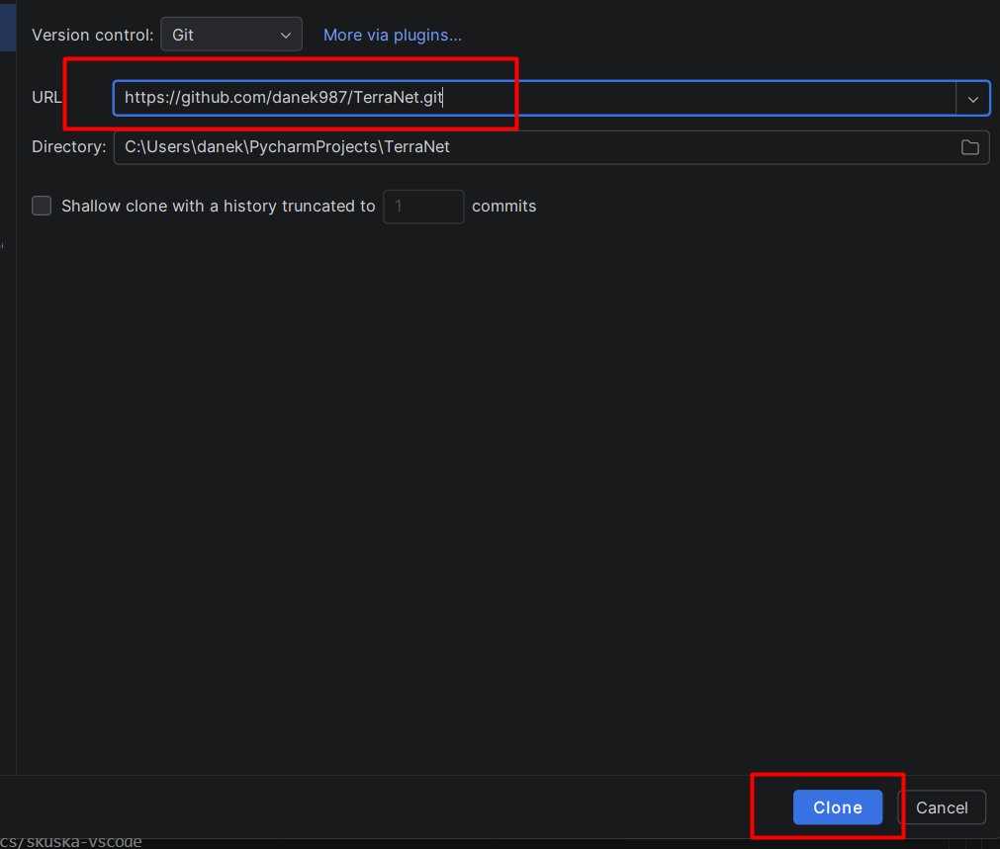

3. Ak príde výzva, vyber **Log In via GitHub** a dokonči prihlásenie v prehliadači.

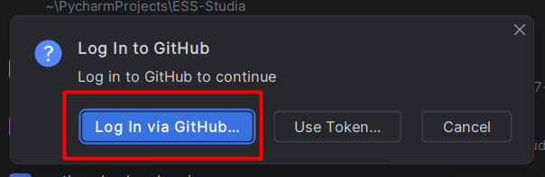

4. Pri otvorení vlastného tímového projektu potvrď **Trust Project**, keď poznáš jeho zdroj. Na ďalšie kroky stačí otvorený súbor README.

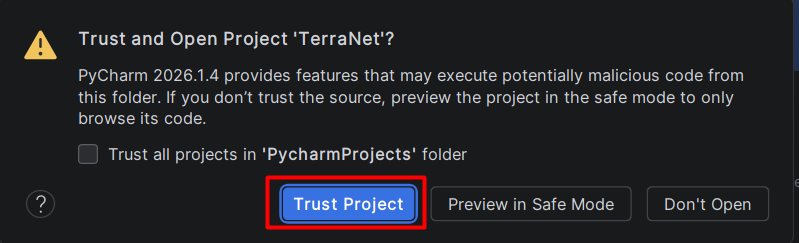

<strong>2. Vytvor pracovnú vetvu</strong>

1. V hornej lište otvor ponuku vetvy **main** a klikni na **New Branch**.

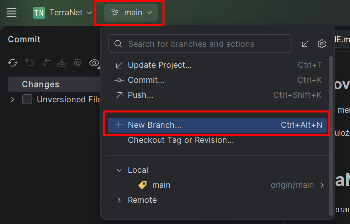

2. Zadaj `docs/skuska-pycharm`, ponechaj **Checkout branch** a klikni na **Create**.

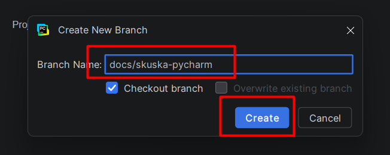

3. Over, že v hornej lište už vidíš novú vetvu.

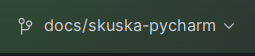

<strong>3. Uprav súbor a odošli commit</strong>

1. Otvor `README.md` a doplň krátku skúšobnú vetu. V PyCharme môžeš uloženie vyvolať cez **File → Save All**.

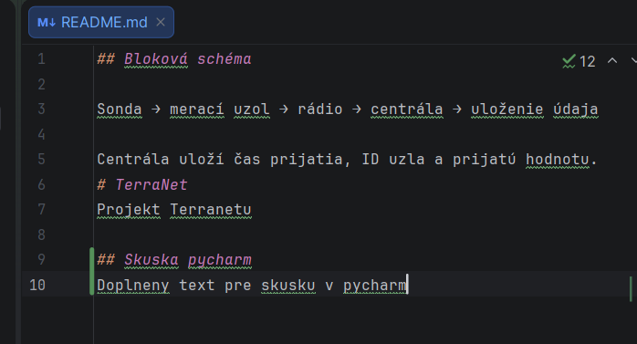

2. Otvor panel **Commit**, napríklad cez `Ctrl + K`, a zaškrtni upravený súbor. Kliknutím naň skontroluj rozdiel.

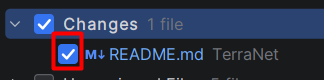

3. Napíš popis, napríklad `Doplň poznámku do README z PyCharmu`, a klikni na **Commit and Push**.

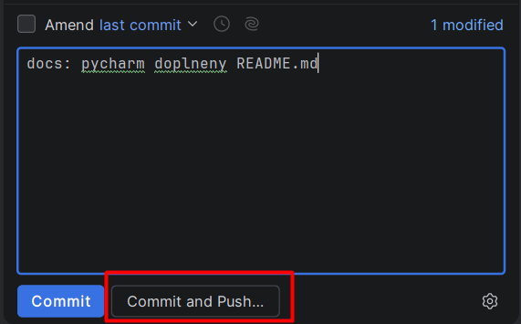

4. V dialógu skontroluj, že odosielaš `docs/skuska-pycharm` do rovnako pomenovanej vetvy pri `origin`. Potvrď **Push**.

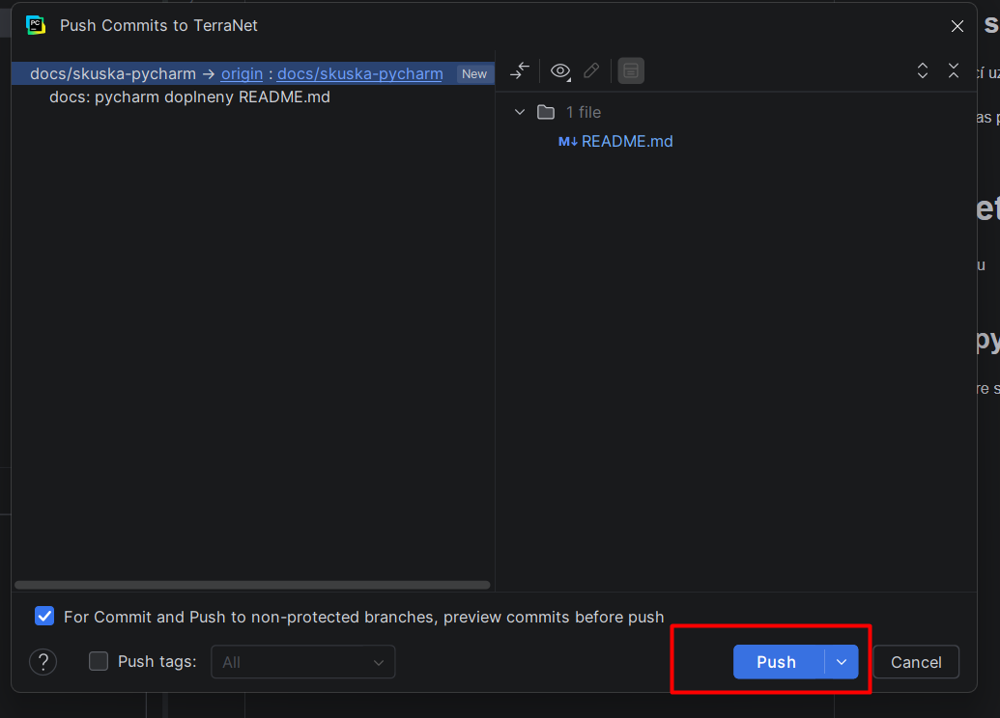

Úspešné hlásenie potvrdí, že vetva je na GitHube.

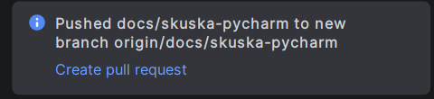

<strong>4. Otvor pull request</strong>

1. V úspešnom hlásení klikni na **Create pull request**. Prípadne otvor **Git → GitHub → Create Pull Request**.
2. Skontroluj cieľ **TerraNet:main** a zdroj **TerraNet:docs/skuska-pycharm**. Doplň názov, popis a podľa potreby kontrolujúceho spolužiaka.

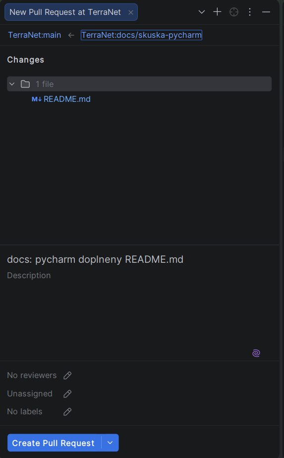

3. Klikni na **Create Pull Request**. Spolužiak potom môže pokračovať [kontrolou na GitHube](../review/README.md).

<strong>5. Po zlúčení aktualizuj main</strong>

1. Keď je pull request zlúčený, ulož vlastnú rozpracovanú prácu commitom alebo stashom. V ponuke vetiev vyber **main → Checkout**.

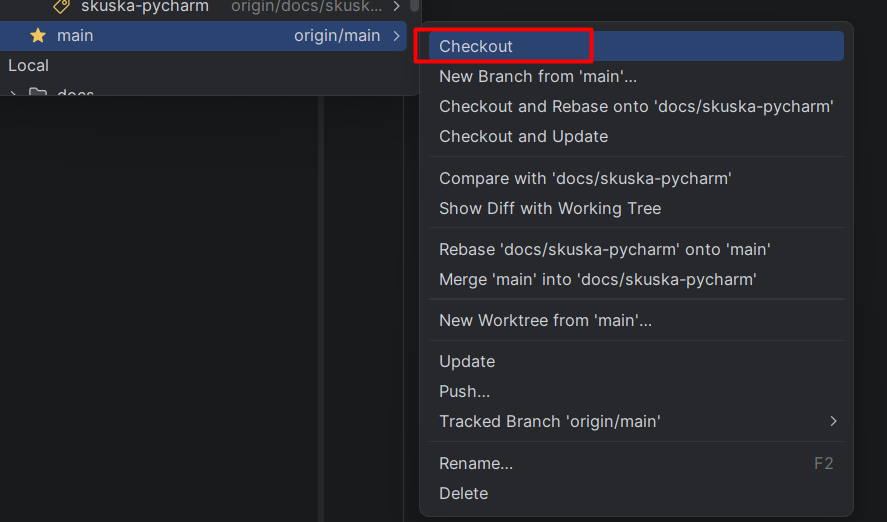

2. Na vetve `main` klikni na **Update Project**, prípadne použi `Ctrl + T`.

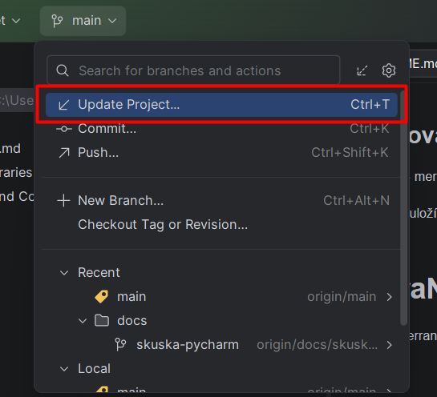

3. Ak príde výber spôsobu aktualizácie, pre toto cvičenie ponechaj **Merge incoming changes into the current branch** a potvrď **OK**.

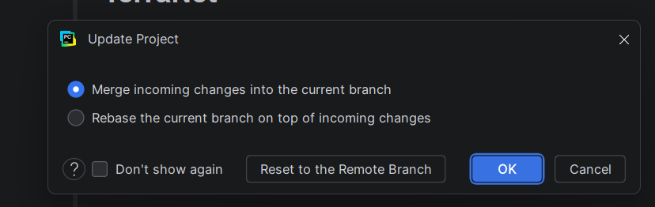

V README skontroluj prijatú zmenu. Z aktuálnej vetvy `main` môžeš vytvoriť vetvu pre ďalšiu úlohu.

[PyCharm – klonovanie](https://www.jetbrains.com/help/pycharm/manage-projects-hosted-on-github.html) · [Commit a Push](https://www.jetbrains.com/help/pycharm/commit-and-push-changes.html) · [Pull request](https://www.jetbrains.com/help/pycharm/create-and-merge-github-pull-requests.html)
