# Kontrola a oprava pull requestu

[Späť na návody pre GitHub](../README.md) · [Úvod TerraNetu](../../README.md)

Autor pridal skúšobnú poznámku do README. Spolužiak skontroluje zmenu a požiada o úpravu. Na snímkach sa skúša odstránenie prázdneho riadka. Vlastnú zmenu môžeš odoslať z [VS Code](../vscode-github/README.md) alebo [PyCharmu](../pycharm-github/README.md).

<strong>1. Autor otvorí pull request</strong>

Na GitHube otvor **Compare & pull request**, zvoľ cieľovú vetvu `main` a svoju pracovnú vetvu. Napíš názov a stručný popis a klikni na **Create pull request**. Spolužiaka môžeš vybrať v **Reviewers** alebo mu poslať odkaz.

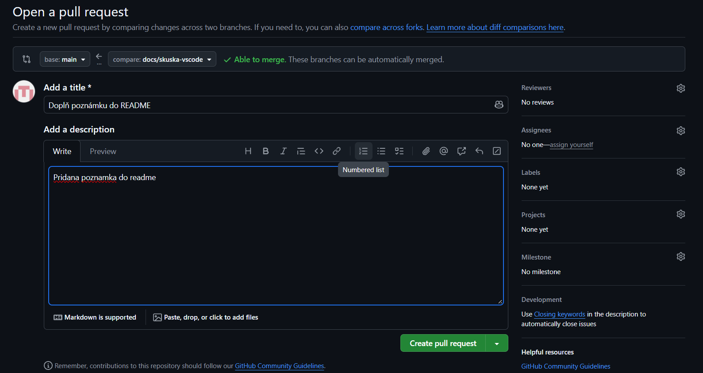

<strong>2. Spolužiak pridá pripomienku k riadku</strong>

1. Otvor pull request a kartu **Files changed**.
2. Pri riadku, ku ktorému chceš niečo napísať, klikni na modré **+**.

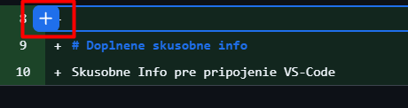

3. Napíš konkrétnu pripomienku. Napríklad „Odstráň tento prázdny riadok.“ Cez **Start a review** ju pridaj do rozpracovanej kontroly.

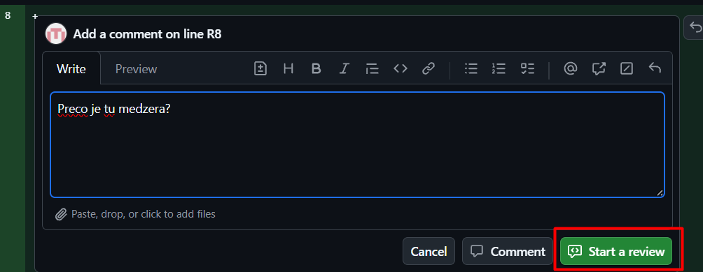

<strong>3. Odošli review</strong>

1. Po kontrole súborov klikni na **Submit review**, prípadne **Review changes** podľa zobrazenia GitHubu.

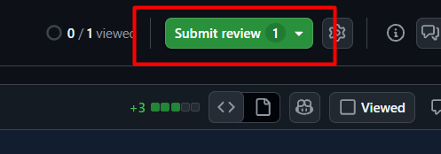

2. Doplň krátke zhrnutie a vyber výsledok:

   - **Comment** odošle spätnú väzbu.
   - **Request changes** požiada autora o opravu.
   - **Approve** schváli zmenu na zlúčenie.

3. Klikni na **Submit review**, aby autor dostal všetky pripomienky.

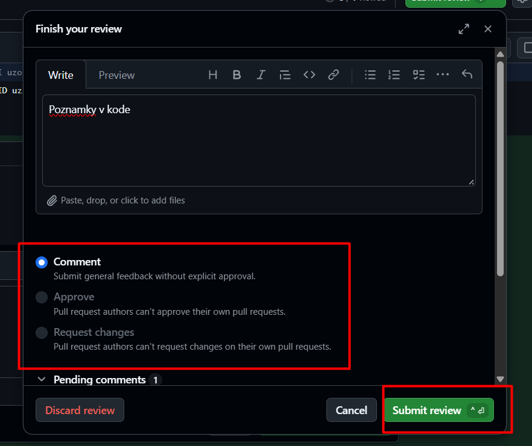

Na snímke kontroluje autor vlastný pull request, preto sú dostupné komentáre. Pre vzájomné schválenie nech review odošle spolužiak zo svojho účtu. Práva a pravidlá vetvy určujú, ktorá kontrola sa započíta pred zlúčením.

<strong>4. Autor opraví tú istú vetvu</strong>

Prečítaj pripomienku a v editore otvor vetvu patriacu k pull requestu. Uprav README a sprav nový commit. Môžeš použiť jeden z týchto postupov:

**PyCharm**

V paneli **Commit** vyber opravený súbor, napíš správu a cez **Commit and Push** odošli opravu. Na snímke vidíš výber README a správu o odstránení medzery.

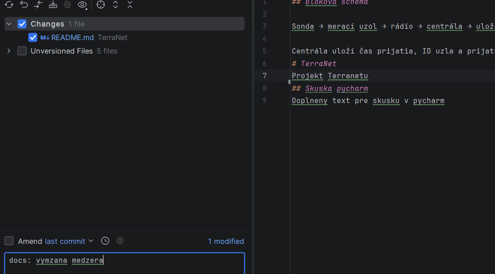

**VS Code**

Vyber opravu do commitu a sprav **Commit**, potom použi **Push**. Na snímke je alternatíva **Sync Changes**. Zobrazené potvrdenie hovorí, že najprv stiahne a zapracuje vzdialené commity a potom odošle tvoje. Pred potvrdením over, že ide o správnu pracovnú vetvu.

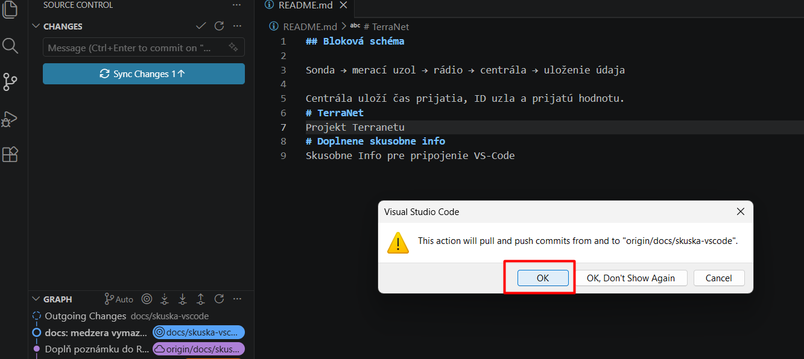

Nový commit sa objaví v pôvodnom pull requeste v karte **Commits**. Skontroluj aj výsledný rozdiel vo **Files changed**.

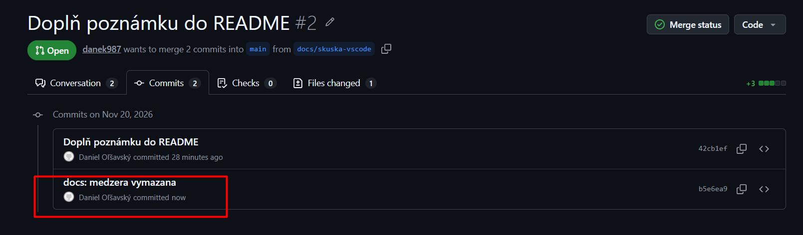

<strong>5. Odpovedz na pripomienku a zlúč zmenu</strong>

1. Pri pripomienke napíš, čo si upravil, a odošli **Comment**.

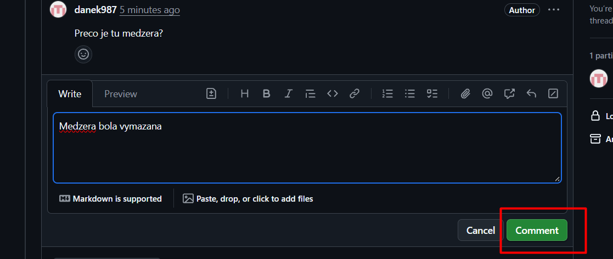

2. Požiadaj spolužiaka o opätovnú kontrolu. Spolužiak overí opravu a podľa výsledku dá **Approve**.
3. Po kontrole môže člen tímu s právom zlúčenia kliknúť na **Merge pull request → Confirm merge**, keď to GitHub povolí.

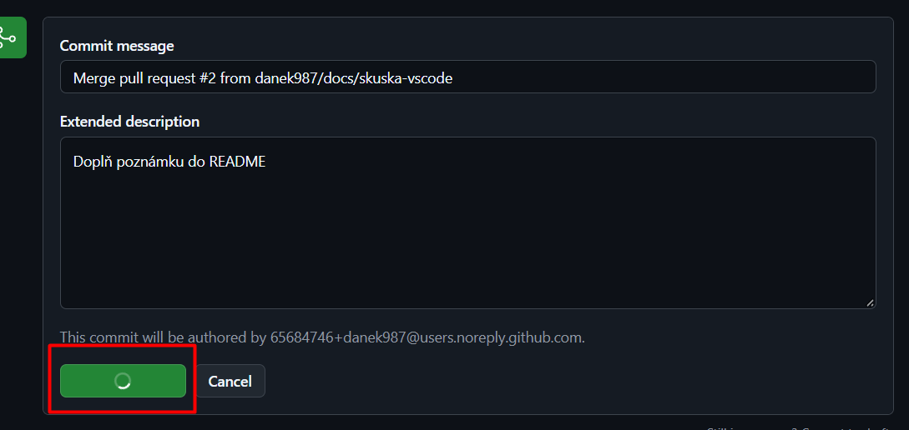

4. Hlásenie **Pull request successfully merged and closed** potvrdí zlúčenie. Over README na `main`, potom si [aktualizuj projekt vo VS Code](../vscode-github/README.md) alebo [v PyCharme](../pycharm-github/README.md).

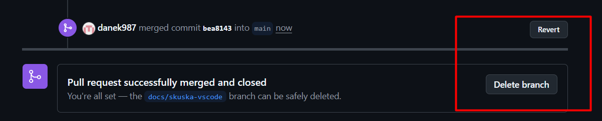

<strong>Voliteľne. Vráť už zlúčenú zmenu cez Revert</strong>

Tento postup použi, keď tím potrebuje odvolať zmenu, ktorá už bola zlúčená.

1. Otvor pôvodný zlúčený pull request a klikni na **Revert**, ktoré vidíš na predchádzajúcej snímke.
2. GitHub pripraví nový pull request s opačnou zmenou. Skontroluj jeho obsah vo **Files changed** a vytvor ho cez **Create pull request**.

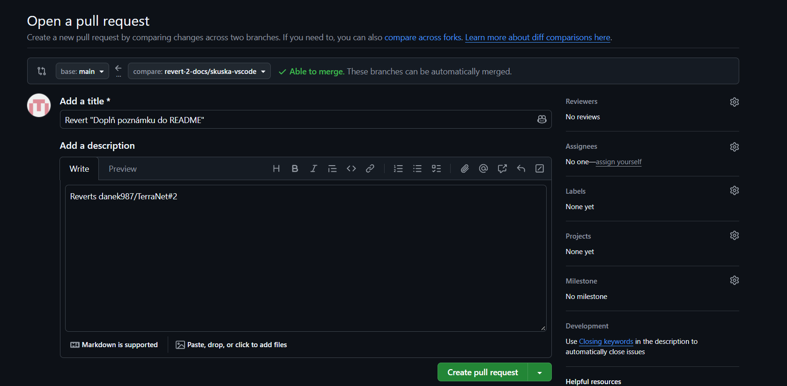

3. Po kontrole zlúč tento nový pull request a potvrď **Confirm merge**. Tým sa vrátenie zapíše do histórie.

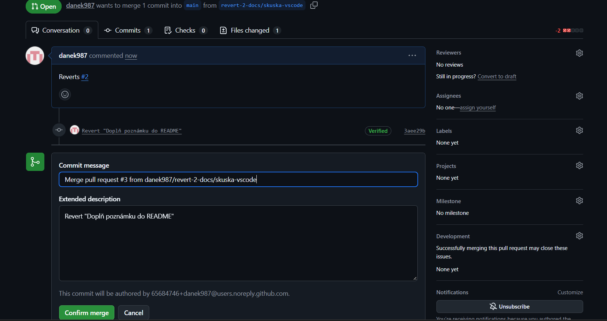

[GitHub – vrátenie pull requestu](https://docs.github.com/en/pull-requests/how-tos/merge-and-close-pull-requests/reverting-a-pull-request)

[GitHub – kontrola pull requestu](https://docs.github.com/en/pull-requests/how-tos/review-pull-requests/reviewing-proposed-changes-in-a-pull-request)
