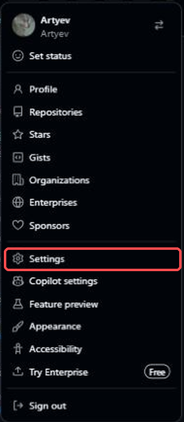
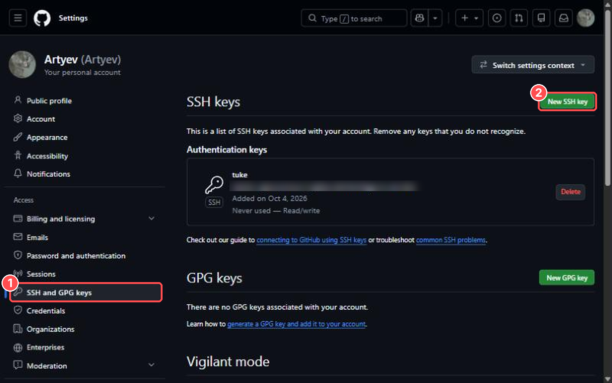
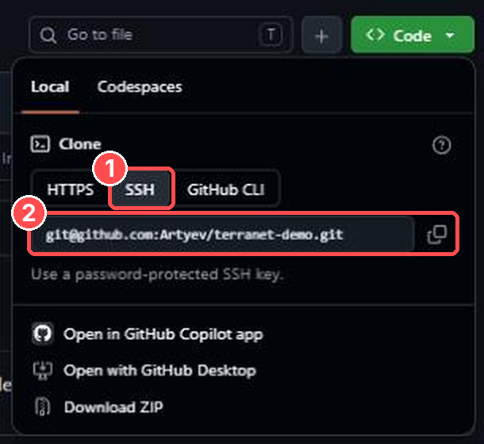

# GitHub cez terminál alebo SSH

[Späť na úvod TerraNetu](../../README.md)

Použi tento postup, ak chceš upraviť súbor na počítači a odoslať zmenu na GitHub cez príkazy. Najprv [nainštaluj Git a nastav meno a e-mail](../git-vscode/README.md). Na Windowse otvor **Git Bash**. Ak je repozitár súkromný, [najprv prijmi pozvánku](../README.md).

<details markdown="block">
<summary><strong>1. Pripoj GitHub cez SSH</strong> · voliteľné, pri HTTPS tento krok preskoč</summary>

1. V Git Bash spusti `ls -al ~/.ssh`. Ak už používaš SSH kľúč pre GitHub, môžeš ho použiť. Ak ešte nemáš kľúč, vytvor ho a pri otázke na umiestnenie potvrď predvolenú cestu, pokiaľ je voľná. Ak sa Git Bash spýta na prepísanie existujúceho kľúča, stlač **n** a použi existujúci kľúč alebo zvoľ nový názov. Pri vytváraní kľúča nastav prístupovú frázu.

   ```bash
   ssh-keygen -t ed25519 -C "tvoj-email@example.com"
   ```

2. Skopíruj obsah verejného kľúča. Ak si zvolil iný názov, uprav cestu. Súbor bez prípony `.pub` je súkromný kľúč a patrí iba do tvojho počítača.

   ```bash
   cat ~/.ssh/id_ed25519.pub
   ```

3. Na GitHube klikni na profilovú ikonu → **Settings → SSH and GPG keys → New SSH key**. Do **Title** zadaj napríklad **Školský notebook**, ako typ vyber **Authentication Key**, vlož celý riadok z verejného kľúča a potvrď **Add SSH key**.

   

   

4. Over spojenie. Pri prvom pripojení porovnaj zobrazený odtlačok servera s [oficiálnym zoznamom odtlačkov GitHubu](https://docs.github.com/en/authentication/keeping-your-account-and-data-secure/githubs-ssh-key-fingerprints). Potvrď ho, ak sa zhoduje. Pri úspechu GitHub vypíše tvoje používateľské meno.

   ```bash
   ssh -T git@github.com
   ```

   Ak má kľúč vlastný názov a SSH ho nevie nájsť, v tom istom okne Git Bash spusti `eval "$(ssh-agent -s)"` a `ssh-add ~/.ssh/nazov_kluca`. Použi názov súboru bez prípony `.pub` a pripojenie znova otestuj.

[GitHub Docs – vytvorenie SSH kľúča](https://docs.github.com/en/authentication/connecting-to-github-with-ssh/generating-a-new-ssh-key-and-adding-it-to-the-ssh-agent?platform=windows) · [Pridanie kľúča do účtu](https://docs.github.com/en/authentication/connecting-to-github-with-ssh/adding-a-new-ssh-key-to-your-github-account?platform=windows) · [Overenie spojenia](https://docs.github.com/en/authentication/connecting-to-github-with-ssh/testing-your-ssh-connection)

</details>

<details markdown="block">
<summary><strong>2. Naklonuj repozitár</strong></summary>

1. Na stránke tímového repozitára klikni na **Code**. Vyber **SSH**, ak máš nastavený kľúč, alebo **HTTPS**, ak sa chceš prihlásiť cez správcu prihlasovacích údajov Gitu. Skopíruj adresu.

   

2. V Git Bash prejdi do priečinka, kde chceš mať projekt. V príkaze nahraď ukážkovú adresu skopírovanou adresou a potom otvor vytvorený priečinok. Ak sa repozitár volá inak, uprav aj `cd TerraNet`. Ak už máš lokálnu kópiu, otvor jej priečinok a pokračuj ďalším krokom.

   ```bash
   git clone git@github.com:VLASTNIK/TerraNet.git
   cd TerraNet
   ```

</details>

<details markdown="block">
<summary><strong>3. Vytvor vetvu a odošli zmenu</strong></summary>

1. Začni s čistým pracovným priečinkom. Výpis `git status` ti ukáže, či v ňom už máš rozpracované zmeny. Aktualizuj `main` a založ pracovnú vetvu. Ak `git pull --ff-only` skončí chybou, zastav sa a skontroluj, prečo sa lokálna a vzdialená vetva rozchádzajú.

   ```bash
   git status
   git switch main
   git pull --ff-only
   git switch -c docs/blokova-schema
   ```

2. V editore otvor `README.md`, doplň blokovú schému a súbor ulož. Cez `git diff` skontroluj úpravu, potom pridaj súbor do commitu a odošli vetvu na GitHub. Po prvom pushi s `-u` stačí na tej istej vetve `git push`.

   ```bash
   git diff -- README.md
   git add README.md
   git commit -m "Pridaj blokovú schému TerraNetu"
   git push -u origin docs/blokova-schema
   ```

3. Na GitHube otvor [pull request z pracovnej vetvy do `main`](../README.md) a požiadaj spolužiaka o [kontrolu zmeny](../review/README.md). Keď je pull request zlúčený, aktualizuj si lokálnu hlavnú vetvu.

   ```bash
   git switch main
   git pull --ff-only
   ```

</details>

## Rýchla pomôcka

| Príkaz | Čo robí |
| --- | --- |
| `git clone` | Stiahne repozitár ako nový priečinok. |
| `git switch` | Prepne vetvu. S `-c` vytvorí novú. |
| `git status` | Ukáže aktuálnu vetvu a stav súborov. |
| `git diff` | Ukáže, ktoré riadky si upravil a ešte nepridal cez `git add`. |
| `git add` | Pripraví vybraný súbor do ďalšieho commitu. |
| `git commit` | Uloží pripravené zmeny do lokálnej histórie. |
| `git push` | Odošle lokálne commity na GitHub. |
| `git pull` | Stiahne a začlení zmeny zo vzdialenej vetvy. |

[Oficiálna pomôcka ku Gitu (PDF)](https://git-scm.com/cheat-sheet.pdf) · [Interaktívne cvičenie Learn Git Branching](https://learngitbranching.js.org/)
