# GitHub vo Visual Studio Code

[Späť na návody pre GitHub](../README.md) · [Úvod TerraNetu](../../README.md)

Stiahneš repozitár, vytvoríš pracovnú vetvu a odošleš prvú zmenu. Pred začiatkom [nastav Git](../git-vscode/README.md) a pri súkromnom repozitári prijmi pozvánku. Na snímkach je ukážkový repozitár TerraNet, použi adresu svojho tímu.

<details markdown="block">
<summary><strong>1. Vyber repozitár a prihlás sa</strong></summary>

1. Na GitHube otvor projekt a v **Code → HTTPS** skopíruj adresu.

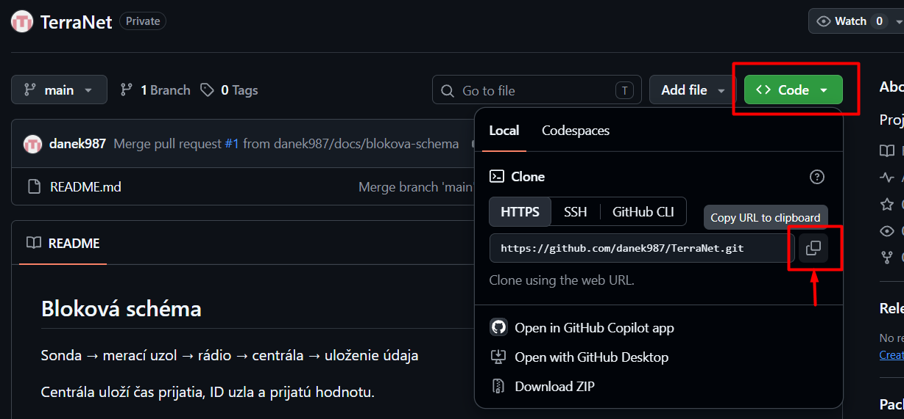

2. Vo VS Code stlač `Ctrl + Shift + P`, vyhľadaj **Git: Clone** a potvrď.

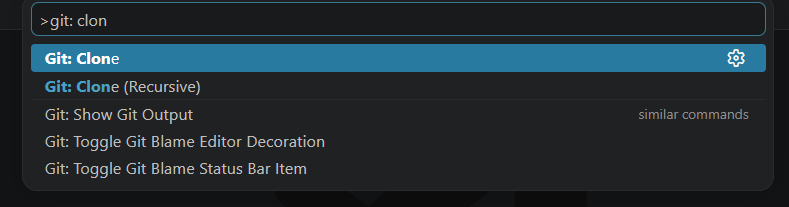

3. Vlož skopírovanú adresu. Ak chceš projekt vybrať zo svojho účtu, klikni na **Clone from GitHub**.

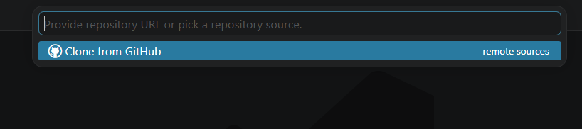

4. Keď príde výzva, klikni na **Allow** a v prehliadači skontroluj účet. Cez **Continue** dokonči prihlásenie a vráť sa do VS Code.

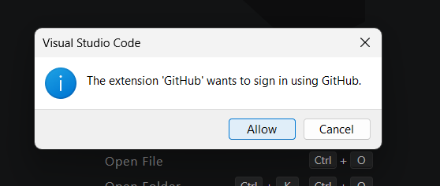

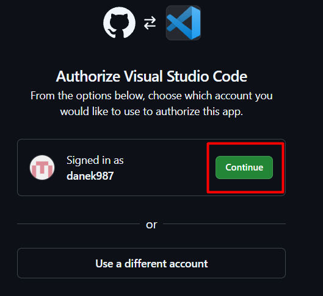

5. Pri výbere cez účet nájdi repozitár **TerraNet** v zozname. Ak si vložil HTTPS adresu priamo, pokračuj výberom priečinka.

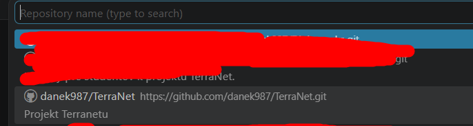

Pri verejnom repozitári sa výzva na prihlásenie môže zobraziť až pri prvom odoslaní zmeny.

</details>

<details markdown="block">
<summary><strong>2. Otvor stiahnutý projekt a over pripojenie</strong></summary>

1. Vyber nadradený priečinok pre projekt a klikni na **Select as Repository Destination**. VS Code doň stiahne repozitár.

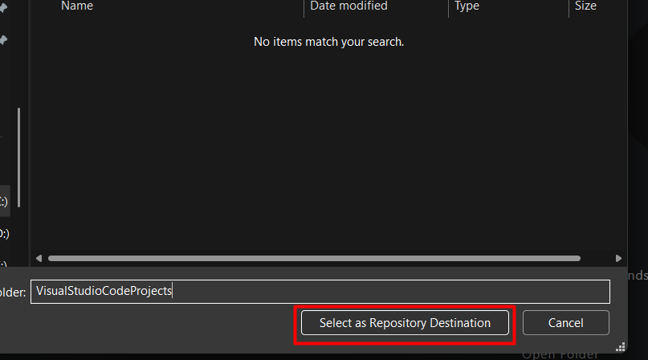

2. Po stiahnutí klikni na **Open**.

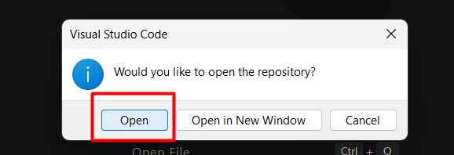

3. Ak vidíš **Restricted Mode**, otvor ho. Pri vlastnom tímovom projekte, ktorého zdroj poznáš, zvoľ **Trust**.

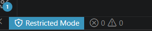

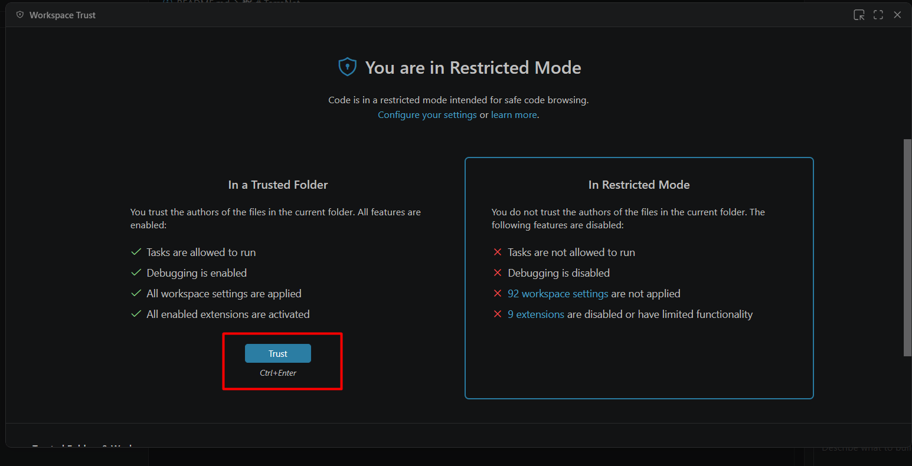

4. V **Terminal → New Terminal** spusti:

```powershell
git remote -v
git status
```

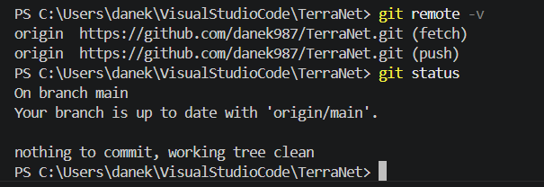

Pri `origin` má byť adresa tímového projektu. `On branch main` znamená, že si na hlavnej vetve, a `working tree clean` znamená, že nemáš neuložené zmeny voči poslednému commitu.

</details>

<details markdown="block">
<summary><strong>3. Vytvor pracovnú vetvu</strong></summary>

1. Na aktuálnej vetve `main` stlač `Ctrl + Shift + P` a vyber **Git: Create Branch**. Na snímke sú dve podobné možnosti, **Create Branch From** navyše umožní zvoliť východiskovú vetvu.

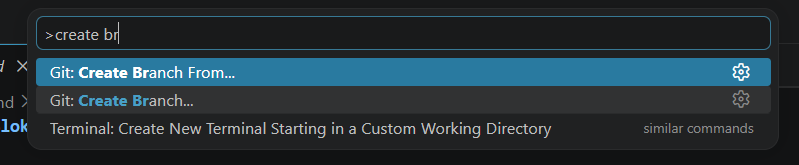

2. Zadaj `docs/skuska-vscode` a potvrď klávesom Enter.

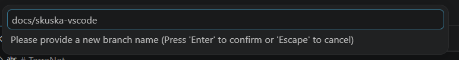

3. Príkazom `git status` si over, že si už na novej vetve.

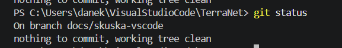

</details>

<details markdown="block">
<summary><strong>4. Uprav README a sprav commit</strong></summary>

1. Otvor `README.md`, doplň krátku skúšobnú vetu a ulož cez `Ctrl + S`.

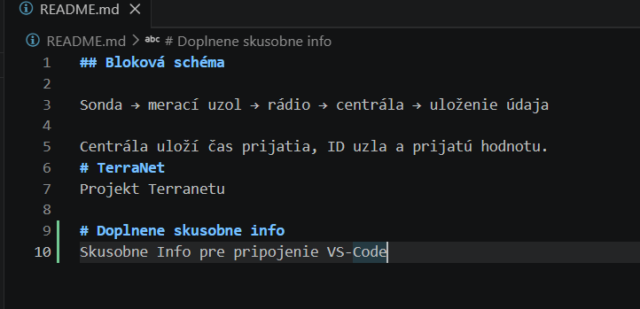

2. Cez `Ctrl + Shift + G` otvor **Source Control**. Klikni na `README.md` a skontroluj zmenu.

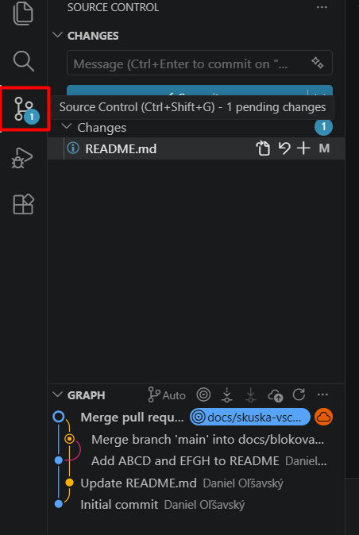

3. Cez **+** pri súbore vyber zmenu do commitu. Na snímke je **Stage All Changes**, ktoré vyberie všetky súbory v časti Changes. Použi ho, keď všetky patria do tejto zmeny.

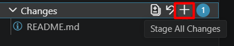

4. Napíš správu `Doplň poznámku do README` a klikni na **Commit**. V **Staged Changes** vidíš, ktoré súbory sa ukladajú do histórie.

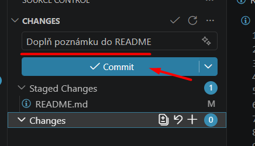

</details>

<details markdown="block">
<summary><strong>5. Odošli vetvu a otvor pull request</strong></summary>

1. Klikni na **Publish Branch**. Pri už publikovanej vetve použi **Push**.

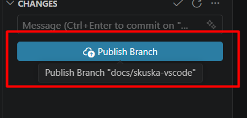

2. Otvor projekt na GitHube a klikni na **Compare & pull request**. Skontroluj cieľovú vetvu `main`, doplň popis a vytvor pull request.

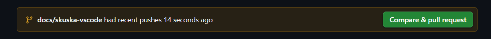

Pokračuj [kontrolou a opravou pull requestu](../review/README.md). Podrobný postup jeho založenia je aj v [návode pre prehliadač](../README.md#prvá-zmena-na-githube).

</details>

<details markdown="block">
<summary><strong>6. Stiahni nové zmeny a pokračuj v práci</strong></summary>

V paneli **Source Control → Graph** nájdeš tieto tlačidlá:

- **Fetch** načíta informácie o vzdialených vetvách a commitoch. Potom vieš, či sú na GitHube nové zmeny.

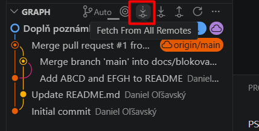

- **Pull** stiahne a zapracuje vzdialené zmeny do aktuálnej vetvy.

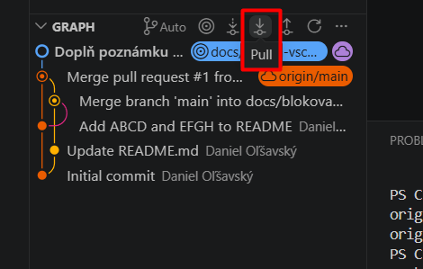

- **Push** odošle tvoje lokálne commity do vzdialenej vetvy.

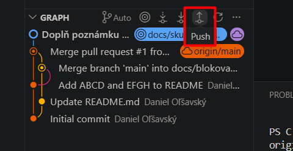

Po zlúčení pull requestu ulož rozpracovanú prácu commitom alebo stashom, prepni sa cez názov vetvy na `main` a spusti **Pull**. Potom vytvor vetvu pre ďalšiu úlohu. Pred každým Pull a Push over aktuálnu vetvu v stavovom riadku.

</details>

[VS Code – GitHub](https://code.visualstudio.com/docs/sourcecontrol/github) · [Fetch, Pull a Push](https://code.visualstudio.com/docs/sourcecontrol/repos-remotes)
